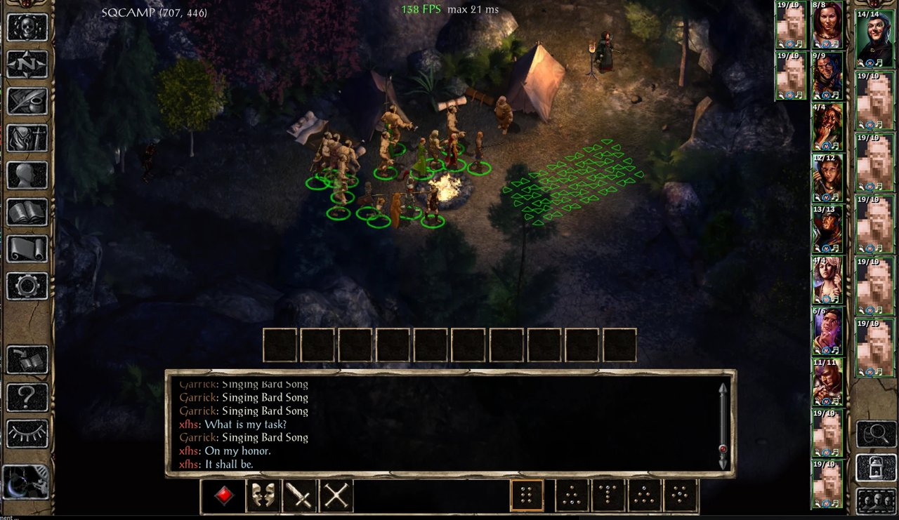
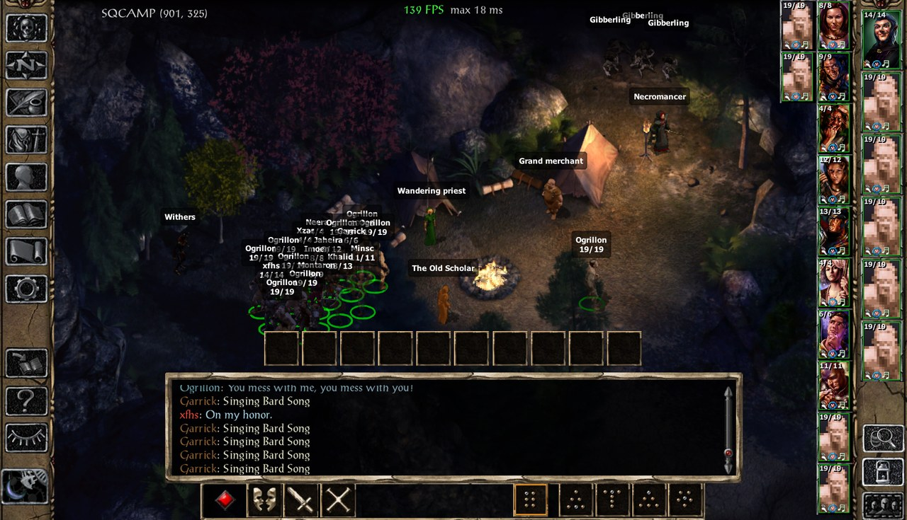
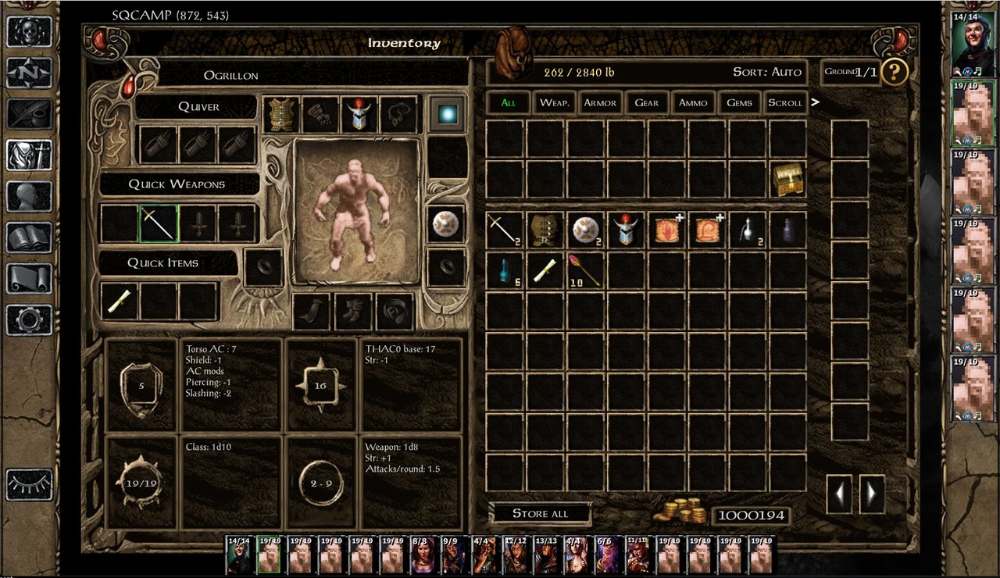

# SadoEE documentation

> **Work in progress.** I had to wrap SadoEE up before leaving on holiday, so everything is still WIP. More balanced options are already planned for every component (today many of them lean on the generous side). Feedback is very welcome: open an issue on GitHub.
>
> Game versions 2.6.6 and 2.7.3, BGEE / EET / BG2EE, EEex required.
> **Install SadoEE at the very end, after every other mod**: it patches the scripts and dialogues present at install
> time (see [COMPATIBILITY.md](../COMPATIBILITY.md)).





## All components at a glance (to review)

| # | Component | In one line | Games |
|---|---|---|---|
| **Party Stash** | | | |
| 0-4 | Party Stash | One infinite stash shared by the whole party on a redesigned inventory page; BG1 or BG2 look | all |
| 1 | Sorted loot | Ground, containers and loot bar sorted: quest items, weightless items, then value | all |
| 5 | Option: weightless stash | The stash weighs nothing | all |
| 6 | Option: keep the gold | Party gold survives the campaign changes (BG1 → SoD → BG2 in EET) | all |
| 7 | Option: hardcore | Campaign changes empty the stash too | all |
| **Rest camp** | | | |
| 10 | Rest camp + priestess | A quiet camp from the world map (0 h there and back, safe rest). The priestess heals HP / poison / disease for free (also while you sleep), sells resurrection / restoration / curse removal, takes donations for reputation | all |
| 11 | Grand merchant | Sells every item seen in the stores you visited | all |
| 12 | The Old Scholar | Identifies everything, party and stash, 80 gp per item; opens the item Codex | all |
| 13 | Waiting at the camp | A member who leaves the party can wait for you around the fire | all |
| 14 | Withers: respec | A lich who fully remakes a party member (race, class, kit, abilities...), free; works on recruited creatures too | all |
| 15 | Withers: recruit | New companions made in the game's creation screens or imported, free | all |
| 16 | Quest chronicle | Every quest of the game: status, journal, hints, full solution | all |
| 17 | Necromancer | Raises any creature of the game: undying target dummy with a damage meter, unleash it to fight, or recruit it | all |
| 50-53 | Priestess prices | Her paid healing at 75 / 50 / 25 % or free | all |
| **Quality of life** | | | |
| 20 | Passive trap detection | Thieves spot traps without the Find Traps mode | all |
| 21 | Valuable containers | Containers holding something valuable get a gold outline | all |
| 22 | Automatic disarming | Idle thieves disarm detected traps; a click on a trapped / locked container sends the best disarmer, lockpicker or basher | all |
| 23 | FPS counter | FPS and slowest frame at the top of the screen (F12) | all |
| 24 | Endless ammo | Basic arrows, bolts, bullets, darts are never used up | all |
| 25-26 | Small party footprint | No more jams in corridors (1 square or none per character) | all |
| 27 | Lasting modes | Bard song, turn undead, stealth, shaman dance stay on while acting | all |
| 28 | Attack-move | RTS-style move that fights every enemy on the way | all |
| 29 | Mouse buttons | Middle click, buttons 4-8, Shift/Ctrl + wheel run SadoEE actions | all |
| 30 | Keep gear on death | The party keeps its equipment when someone dies | all |
| 31 | Chests in the ground bar | Visible unlocked containers listed in the ground items bar | all |
| 32 | Auto-Roller | Auto-Roll button in character creation keeps the best of many rolls | all |
| **Engine extension** | | | |
| 40 | Big party | 7 to 32 members, extra portrait bar, working banter and interjections for members 7+ (scripts and dialogues extended at install) | BGEE, EET |

"Games: all" = BGEE, EET and BG2EE. To check in the review: banter with members 7+, level up of respecced
creatures, equipping items on creatures. (Banter 7+: checked in game by John, 2026-10-25.)

---

## Party Stash (#0-#7)
_To write: the inventory page, the stash, bags, sorting options (auto, DPS, AC, type, weight, date, price, price/lb,
level, quality), Store all, Sell marked, uninstall note (Ctrl + click on the weight bag empties the stash)._

## Rest camp (#10-#17, #50-#53)
_To write: how to reach it (parchment over Travel), leaving (exit corner, like a map edge), BG2EE site (Helmite
Camp), each resident with screenshots._

### Priestess (#10, #50-#53)
### Grand merchant (#11)
### The Old Scholar, Codex and quest chronicle (#12, #16)
### Waiting at the camp (#13)
### Withers: respec and recruit (#14, #15)
### Necromancer (#17)

## Quality of life (#20-#32)
_To write: one short paragraph per component, with its options (EEex Options menu, key bindings)._

## Big party (#40)
_To write: how to enable, limits, known issues._

---

# Technical reference: everything SadoEE changes

Per component: what it does, the files it adds, the game files it modifies (and how), the engine and runtime
changes (EEex hooks, memory patches with their v2.7.3 / v2.6.6 addresses), what it stores in saves and what
uninstalling leaves behind, and its install-time conditions. Written from the installer and the code of v1.0.0.

Several components read or patch **every** file of a type present at install time (ITM, STO, CRE, DLG, BCS):
that is why SadoEE must be installed after every other mod.

## Known issues (v1.0.0)
- #15 Withers recruit and #16 quest chronicle: when their requirement is missing, the refusal message wrongly
  says "Requires EEex."
- #14 Withers respec: without Party Stash, gear the new character cannot use is not unequipped.
- #10: SQPRIEST.STO is still installed although nothing opens it any more (harmless).
- #32 Auto-Roller: its texts are English only.
- #40 Big party: loading a save with 7+ members after uninstalling #40 is not handled.
- Some code comments still use the old SadoQoL / Party Stash component numbers.

### Party Stash (#0-#7)

Sources: `SadoEE.tp2` (components `DESIGNATED 0` to `7`), `SadoEE/lib/main.tpa`, `lib/quest_items.tpa`, `lib/strings.tpa`,
`M_PSTASH.lua`, `M_SQSORT.lua`, `pages/<look>_<game>/PSTASH.menu`, `SQSORT.menu`.

All eight components are in WeiDU group `@2000` ("Party Stash").

**Mod-wide guard (`ALWAYS` block).** Each install stops with `@2010` if any of these is installed: `PartyStash.tp2`
components 0-9 and 40, or `SadoQoL.tp2` components 0-3 and 5-24. SadoEE uses the same override file names as those
two mods. `SadoQoL.tp2` #4 is not in the list.

**Component numbers and looks.**

| # | Label | Game group (`SUBCOMPONENT`) | `ps_look` |
|---|---|---|---|
| 0 | `SADOEE-MAIN` | `@1`, `GAME_IS ~bgee~` | `bg1` (BG1 look on BGEE, "recommended") |
| 4 | `SADOEE-MAIN-BG2-LOOK-ON-BGEE` | `@1`, `GAME_IS ~bgee~` | `bg2` |
| 2 | `SADOEE-MAIN-BG2-LOOK` | `@11`, `GAME_IS ~bg2ee eet~` | `bg2` (BG2 look on BG2EE/EET, "recommended") |
| 3 | `SADOEE-MAIN-BG1-LOOK-ON-BG2` | `@11`, `GAME_IS ~bg2ee eet~` | `bg1` |
| 1 | `SADOEE-SORTED-LOOT` | none | none |
| 5 | `SADOEE-OPT-WEIGHTLESS` | none | none |
| 6 | `SADOEE-OPT-KEEPGOLD` | none | none |
| 7 | `SADOEE-OPT-LOSESTASH` | none | none |

---

#### #0, #2, #3, #4 Party Stash (main component, four looks)

##### What it does
One stash shared by the whole party, shown on a replacement inventory page as an 8 x 7 scrollable grid with 12
category tabs (All, Weap., Armor, Gear, Ammo, Gems, Scroll, Potion, Quest, Notes, Misc, Bags). The stash is a bag
store, `PSTASH.STO`. Each party member carries a "Stash" bag item (`PSTASH.ITM`) in backpack slot 33, so the
engine treats the stash contents as carried (quest checks see them). Other features: carried weight shared against
the sum of the members' allowances, collected bags, sale marks with a "Sell Marked" merchant button, a ground-items
column, a companion bar, a helmet-hide toggle and DPS tooltips. The four components share one body
(`INCLUDE ~SadoEE/lib/main.tpa~`). They differ only in `ps_look` (`bg1`/`bg2`) and in the game check.

##### Files added to override
| Resource | Source | What it is |
|---|---|---|
| `PSTASH.menu` | `pages/<ps_look>_<ps_game>/PSTASH.menu` (`ps_game` = `bgee` on BGEE, `bg2ee` on BG2EE/EET) | Defines menus `PSTASH_TICK` (per-frame tick label), `PSTASH_COMPBAR` (companion bar), `INVENTORY` (the new inventory page), `PSTASH_STORE` ("Sell marked" over a merchant's buy/sell panel). Loaded at runtime by `EEex_Menu_LoadFile('PSTASH')`. |
| `INVPSTSH.MOS` | `art/` (BG1 look) or `art/bg2/` (BG2 look) | Page background |
| `PSTASHUP.BAM` | `art/` | Level-up "+" marker (upgrade / learnable scroll) |
| `PSTASHIC.BAM` | `art/` | Stash item icon (the game's chest icon, CONTCHST) |
| `PSTASHDP.BAM` | `art/` | Stash item description picture |
| `PSTASHSL.BAM` | `art/` | "To sell" marker (gold pile) |
| `PSTASHOR.BAM` | `art/` | "Valuable" cell/slot tint (old gold, about 25 %) |
| `PSTASHDK.BAM` | `art/` | "To sell" cell/slot tint (black, about 75 %) |
| `PSARROW.BAM` | `art/` | Help overlay arrows |
| `PSHELP.BAM` | `art/` | "?" help button |
| `PSHELMT.BAM` | `art/` | Paperdoll helmet toggle |
| `PSSLOT.BAM` | `art/PSSLOT_<ps_game>.BAM` | Copy of the game's STONSLOT under another name, so a UI mod replacing STONSLOT does not change the page's slots |
| `PSTSLOT1.BAM`, `PSCONTB1.BAM`, `PSINVBT1.BAM`, `PSBUTNT1.BAM`, `PSPRC1.BAM` | `art/` | BG1-look copies of game BAMs (slots, weight bag, colours button, Store all, ground arrows). Copied for every look. |
| `PSTSLOT2.BAM`, `PSCONTB2.BAM`, `PSINVBT2.BAM`, `PSBTACT2.BAM` | `art/bg2/` | BG2-look equivalents. Copied for every look. |
| `PSTASH.STO` | built from `BAG02.STO` | The stash store (see below) |
| `PSTASH.ITM` | built from `BAG02.ITM` | The Stash item (see below) |
| `M_PSTASH.lua` | `M_PSTASH.lua`, with three generated tables filled in | All runtime logic |
| `M_PSTXT.lua` | `lib/M_PSTXT.lua` (`EVALUATE_BUFFER`) | `PStash_Strings` table, UI strings in the install language (`tra/<language>/ui.tra` `@100`-`@210`, over `tra/english/ui.tra`). Only copied if `lib/strings.tpa` exists, which it does in this build. `M_PSTASH.lua` falls back to its English table `P.EN`. |

`PSTASH.STO` (copy of `BAG02.STO`):
- `0x08` = 5 (bag store type);
- `0x0c` = `@3` ("Stash");
- `0x22` (short) = 65000 (capacity);
- `0x38` = 0 (no starting stock);
- a new purchase-type list is appended at end of file: `0x2c` = its offset, `0x30` = 73 entries. It lists item types 0-73 except 36 (bags).

`PSTASH.ITM` (copy of `BAG02.ITM`):
- names `0x08`/`0x0c` = `@3`, descriptions `0x50`/`0x54` = `@4`;
- price `0x34` = 0, weight `0x4c` = 0;
- flags `0x18` with bit `0x4` cleared (comment: "not droppable");
- icons `0x3a`/`0x44` = `PSTASHIC`, description picture `0x58` = `PSTASHDP`.

##### Existing game files modified
Every scan below uses `COPY_EXISTING_REGEXP GLOB` over **all** files of the type in the game at install time. A mod
installed later is not seen (COMPATIBILITY.md: install SadoEE last, after UI mods).

| Resource type | Scan | Written back? | Rule |
|---|---|---|---|
| `*.ITM` (all) | Bag list | No (read only) | Item type (`0x1c`) = 36, resref not `PSTASH`, and a `.sto` of the same name exists. The result goes into `P.BAG_RES` in `M_PSTASH.lua` (`-- BAGS:BEGIN ... -- BAGS:END`). |
| `*.STO` (all) | Merchants | No | Signature `STORV1.0`, flags (`0x10`) bit `0x2` set, name strref (`0x0c`) valid. For each name strref: the highest buy % (`0x18`) and the union of the purchased item types (`0x2c`/`0x30`), merged by store name. The result goes into `P.STORES` (`-- STORES:BEGIN ... -- STORES:END`; `P.STORE_TYPES` is emptied, the type set is written inline). |
| `*.DLG` (all) | Single-creature quest items | No | `HasItem` / `HasItemEquiped` / `HasItemEquipedReal("RES", <obj>)` where `<obj>` is not `Myself`: `ps_keep`. |
| `*.BCS` | Same, scripts | No | Only scripts holding the compiled trigger ids `16481` (HasItem 0x4061), `16511` (HasItemEquiped 0x407F) or `16578` (HasItemEquipedReal 0x40C2) at the start of a line are decompiled. Then `HasItem*("RES", Player1-6 / LastTalkedToBy / Protagonist / [PC])` adds to `ps_keep`. |
| `*.STO` (all) | Items sold | No | Every item in a store's sale list (`0x34`/`0x38`, 0x1c bytes per entry) goes in `ps_sold`. A sold item is removed from `ps_keep`, and only items whose `.itm` exists are kept. The result goes into `P.KEEP` (`-- KEEP:BEGIN ... -- KEEP:END`). |
| 474 named `*.ITM` (`lib/quest_items.tpa`, generated by build_quest.py) | Quest items | Yes | Weight `0x4c` = 0, if the file exists and is longer than 0x50 bytes. |
| `*.ITM` (all) | Critical / kept items | Yes, only changed files (`BUT_ONLY`) | If length > 0x72 and (flags `0x18` bit `0x1` "critical" is set, or the resref is in `ps_keep`): weight `0x4c` = 0. |
| `UI.MENU` | Text patches | Yes | See below. |

`UI.MENU` patches (`REPLACE_TEXTUALLY EXACT_MATCH`; a string that is not found is skipped without error):
1. `name 'INVENTORY'` becomes `name 'INVENTORY_ORIG'`. The game's page is kept under that name, and `PSTASH.menu` supplies `INVENTORY`.
2. `function slotDoubleClick(slotName, force)` gets this first line: `if PStash_SlotDoubleClick and PStash_SlotDoubleClick(slotName) then return end` (Shift + double-click a backpack item sends it to the stash).
3. Store sell list, `isBag == 1` branch: the condition also requires `res ~= 'PSTASH'`, so the stash is never opened as a bag from a store. The comment says the game crashes otherwise.
4. Item description "open" button: `storeScreen:OpenBag(...)` is skipped for `PSTASH`.
5. Store sell-list click (`if store.groupItems[...].valid ~= 0 then`): the click is skipped for `PSTASH` and for items marked valuable (`PStash_IsValuable`). The comment says a click on the stash froze the game.
6. Store row `enabled` expression: the `PSTASH` row and valuable items are greyed like unsellable items.
7. Container panel, applied only if both `area 575 76 71 28` and `worldScreen:TakeAllFromContainer()` are present (the game's own layout; UI mods keep theirs). The `GUIGOLD` icon moves from `area 568 20 78 50` to `574 4 66 42`. The gold text moves from `575 76 71 28` to `575 46 71 28`. A new `ROUNDBUT` button (`area 591 82 32 32`) is added after the take-all button. Its action is `PStash_DumpHere()` and its tooltip `PStash_T('container_tip')`: it puts the backpack or the shown stash page into the open container.

##### Engine / runtime changes (`M_PSTASH.lua`)
- **Engine function stubs.** `PStash_Ready()` identifies the build from `CInfGame::AddPartyGold`'s bytes (probe at `0x14026DAC0` on 2.7.3.0, `0x14026D860` on 2.6.6.0). It then checks the prologue bytes of each target and builds a small x64 `lua_CFunction` stub for it with `EEex_AllocNear` and `EEex_DisableCodeProtection`/`EEex_WriteU8`. Each stub is exposed as global `PStash_Eng_<name>` (`EEex_ExposeToLua`). On an unknown build, or if a prologue does not match, `P.ready = false` and the stash functions refuse to work ("engine build not supported").

  | Name | 2.7.3.0 | 2.6.6.0 |
  |---|---|---|
  | `AddItemToStore` (CInfGame::AddItemToStore) | `0x14026D680` | `0x14026D420` |
  | `SwapItemPersonal` (CInfGame::SwapItemPersonalInventory) | `0x1402913C0` | `0x140290E00` |
  | `AddDisposableItem` | `0x14026D660` | `0x14026D400` |
  | `DemandServerStore` | `0x1402728F0` | `0x140272680` |
  | `GetServerStore` | `0x140278F00` | `0x140278A70` |
  | `ReleaseServerStore` | `0x140285C60` | `0x140285760` |
  | `TakeItemFromStore` | `0x140292B00` | `0x140292480` |

  The code comments say BGEE and BG2EE share these addresses on each build. `PStash_Eng_ProcessEffectList` is
  created on first use: it starts from EEex label `Hook-CGameSprite::ProcessEffectList()-FirstRandCall` and walks back
  to the int3 (`0xCC 0xCC`) padding, searching at most 0x4000 bytes. It refreshes a companion's stats while the game
  is paused. A 64-byte scratch buffer comes from `EEex_Malloc(64)`.
- **Direct memory writes.**
  - Party gold at `CInfGame + 0x7988` (`GOLD_OFF`, 2.7.3.0 and 2.6.6.0), used to pay "Sell marked" while the store is open. The code checks the field against `GetPartyGold()` first. If it does not match, the gold is paid with `GiveGoldForce(n)` once the store is closed.
  - Helmet hide: `CGameAnimationTypeCharacter` `m_renderHelmet` (`0x2414`) and `m_bEquipHelmet` (`0x2418`) are written to 0 every tick. Only for animation ids `0x5000`-`0x6FFF`, and only when both fields read 0 or 1.
  - The container item list is edited in place. Item pointers are moved between slots (`m_equipment.m_items:set`) for companions and for the Stash-item slot.
- **Effects applied at runtime** (`EEex_GameObject_ApplyEffect`):
  - Overweight slow: on every carrier, opcode 321 (remove by resource `PSTASHW`). While load > capacity, it also applies opcode 176 with amount 50, `dwFlags` 5, timing 0, duration 3, source resource `PSTASHW`. The weight check runs every 2 s.
  - Companion equipment moves: opcode 321 on the item's resref, then the item's global "while equipped" (timing 2) feature blocks are re-applied per worn copy.
- **Weight rule** (`PStash_Weight`): load = items in slots 0-38 of each carrier (portraits 0..`PSXP7_LastPortrait()` or 5, plus companions) + stash entries. Capacity = sum of `STRMOD`/`STRMODEX` `WEIGHT_ALLOWANCE` for live STR/STR-extra (stats 36/37). Stash entries do not count when their type is held by a collected bag, when they are quest items, or when option #5 is on. If a collected bag holds all types, the stash weighs nothing.
- **Stash item placement** (`placeStashItems`, every 500 ms, world/inventory screens only, not at a store or in chargen):
  - each portrait gets one `PSTASH` in slot 33 (`P.DROP_SLOT`), created with `CreateItem("PSTASH",0,0,0)` or moved there;
  - extra copies are destroyed;
  - an item dropped in slot 33 is moved into the stash (`drainDropSlot`). Bags trigger the collect prompt; `P.KEEP` and critical items are refused.

  The file header says "a member with a full backpack gets one item moved to the stash". The tick comment says
  "nothing goes to the stash on its own". No automatic overflow transfer was found in the tick.
- **Collected bags**: a type-36 item that has its own `.sto` can be stored, after a `POPUP_TWOBUTTON` confirmation. Its item is destroyed, its store contents are poured into `PSTASH`, and a count is kept. TBAG01-style bags without a store are refused.
- **Companions** (`PStash_Companions`): familiars (EA 3, no portrait) that are real characters, with locals `JO_JOIN_IS_TRAVELER` or `A7CHR-FOLLOWER` or script name `A7CHR-*`. `A7!*` and `A7AFAAQ` are excluded. They carry their share of the weight and get the `PSTASH_COMPBAR` bar.
- **Listeners and hooks**:
  - `EEex_Menu_AddMainFileLoadedListener`: loads `PSTASH.menu`.
  - `EEex_Sprite_AddLoadedListener`, `EEex_GameState_AddInitializedListener` (twice: push the tick, and clear the cached list on a new or loaded game), `EEex_Menu_AddAfterMainFileReloadedListener`.
  - `EEex_Key_AddPressedListener`: Space on `INVENTORY` = Store all; Escape cancels a pending container dump.
  - `Infinity_PushMenu` is replaced once by a chained wrapper that re-pushes `PSTASH_TICK` after any other menu push, on the world screen only.
  - The tick (`PStash_Tick`, from `PSTASH_TICK`'s `enabled`) also runs `collectgarbage('step', 200)` every frame. The comment says the Lua heap grew to 4 GB at a store.
  - `PStash_DecorateTooltips` edits the engine's `characters[id].equipment` slot tables in place: tints and a DPS line on the weapon tooltips.
  - The `INVENTORY` page's `onOpen`/`onClose` call `PStash_OnInventoryOpen`/`PStash_OnInventoryClose`. These move `WORLD_QUICKLOOT` off screen (offset y 5000), restore its saved offset afterwards, and select the shown character alone while the page is open so the ground column lists that character's items.
- **Optional integrations read at runtime**:
  - `PSXP7_LastPortrait` / `PSXP7_BarWidth` (#40 big party);
  - `BGBot` (bag collection without confirmation; `PStash_SetKeep`, `PStash_AddKeep`, `PStash_StoreAllParty`, `PStash_AutoStoreAll` are a public API);
  - Infinity UI++ `rgInvId` (kept in sync with `id`);
  - LeUI (`buildInventoryStats` detection);
  - class names have SCS / Tweaks `{...}` tags removed (`PStash_ClassText`).
- **Campaign moves** (always on; options #6/#7 change them):
  - BG1 to SoD: an in-memory snapshot (items, bag counts, gold) is taken every 5 s until `SOD_fromimport` = 1. In the new campaign, while `PSTASH_SODDONE` = 0 and the stash is empty, `PSTASH_SODDONE` is set to 1 and the items are recreated, 10 per tick, through a backpack (`CreateItem` + `PStash_Add`). The snapshot is Lua memory only, so it depends on the same game process.
  - EET SoD to BG2 (`CHAPTER` going from 7-12 to 13 or more): by default nothing is done (the stash store stays in the save).

##### Data stored in saves
| Data | Where | Content |
|---|---|---|
| Stash contents | Bag store `PSTASH` in the save | Items, counts, charges, identified flag |
| `PSTB_<RES>` | Global int | Count of collected bags of that resref |
| `PSTBX_N`, `PSTBX_<n>` (string), `PSTBX_<n>A` / `PSTBX_<n>B` (int, 4 characters each) | Globals | Collected bags unknown to the install-time list (added by later mods). The comment says these are the same globals as Party Stash v1.2.2. |
| `PSTS_<RES>` | Global int | Mark per item type: 1 = to sell, 2 = valuable |
| `PSTASH_SODDONE` | Global int | 1 once the BG1 to SoD restore is done |
| `PSHIDEHELM` | Creature local int | 1 = helmet hidden |
| `PSTASH` item | Slot 33 of every party member | The Stash item |
| `PSTASHW` effects | Creature effect list | Opcode 176, duration 3 (transient) |

**What uninstalling leaves.** WeiDU removes the override files and restores the patched `UI.MENU` and ITM files from
its backup. The installer prints `tra/<language>/uninstall.txt` (`@8`) in red at install (`AT_EXIT`) and at an
interactive uninstall (`AT_INTERACTIVE_UNINSTALL`). On Windows this goes through PowerShell; elsewhere `PRINT @8` /
`cat`. The text says to empty the stash first: Ctrl + left click on the weight bag (`PStash_BagClick` /
`PStash_EmptyAll`). That returns the collected bags, filled with the items they can hold, and drops the rest at the
shown character's feet. Otherwise the save keeps the `PSTASH` store contents and the globals above, unreachable until
reinstall. The code does not document what happens to the `PSTASH` items in slot 33 once `PSTASH.ITM` is gone.

##### Install-time options / predicates
- `REQUIRE_PREDICATE MOD_IS_INSTALLED ~EEex.tp2~ (ID_OF_LABEL ~EEex.tp2~ ~B3-EEex-Main~) @2`.
- Each game group is hidden by its `SUBCOMPONENT` predicate. A forced install on the wrong game fails with `@12` (BGEE only) or `@13` (BG2EE/EET only).
- The four looks are mutually exclusive (one `SUBCOMPONENT` group per game).
- Runtime supports builds 2.7.3.0 and 2.6.6.0 only (table `P.BUILDS`).
- Install-order sensitivity: all ITM/STO/DLG/BCS scans and the `UI.MENU` patch see only files present at install time. Bags from later mods are still handled at runtime through `PSTBX_*`.
- Components that need this one: #5-#7, and #11 (camp merchant, `@2013`).

---

#### #1 Sorted loot

##### What it does
Ground piles and containers are sorted in four tiers: quest items, weightless items worth at least
`WEIGHTLESS_MIN` (50 gp), the rest by gp per weight unit, worthless items last. The quick-loot bar
(`WORLD_QUICKLOOT`, `loot.groundItems`) is sorted the same way and merges identical stackable items from every nearby
pile into one "virtual stack" slot. It does not need the stash. It is the same file as SadoQoL #3 (`M_SQSORT.lua`,
`SQSORT.menu`, same override names), so only one copy runs.

##### Files added to override
- `M_SQSORT.lua`: the placeholder `SQ_SORT_QUEST_LIST` is replaced with the generated Lua table of quest items.
- `SQSORT.menu`: menu `SQSORT_TICK` (per-frame tick label calling `SQSort_Tick()`).

##### Existing game files modified
None are written. All scans are read-only (`REPLACE_EVALUATE` returns `%MATCH0%`, with `BUT_ONLY`):
- `*.DLG` (all): `PartyHasItem`, `PartyHasItemIdentified`, `TakePartyItem`, `TakePartyItemNum`, `TakePartyItemAll`, `DestroyPartyItem`, `DestroyPartyItemNum`, `HasItem`, `HasItemEquiped`, `HasItemEquipedReal` `("RES"`, and the second argument of `TakeItemReplace(...)`.
- `*.BCS`: only scripts holding `16450 ` (PartyHasItem 0x4042), `16553 ` (PartyHasItemIdentified 0x40A9) at the start of a line, or `AC\n116OB` / `188OB` / `204OB` (TakePartyItem / TakePartyItemAll / TakePartyItemNum), are decompiled. The party-check names are then matched.
- `*.STO` (all): items sold in any store are removed from the list.

Items whose `.itm` does not exist are skipped. The count is printed (`PartyStash sorted loot: N quest items.`). At
runtime, keys (type 8) and critical items (flag `0x1`) also count as quest items. Gold (type 33) never does.

##### Engine / runtime changes
- Containers (object type 17) of the visible area are re-sorted when their item count changes, and every `FULL_MS` (5000 ms). The check runs every `PERIOD` (1000 ms). The `CPtrList` nodes are reordered in place by rewriting each node's data pointer (`node + 0x10`, `EEex_WritePtr`); no item is created or destroyed.
- `loot.groundItems` is checked every frame and replaced by a sorted copy.
- The global `groundItemClick` (UI.MENU) is wrapped again after each UI reload: one click on a virtual stack calls `worldScreen:OnGroundButtonClick` for each part, highest slotId first per pile.
- Listeners: `EEex_Menu_AddMainFileLoadedListener` (loads `SQSORT`), `EEex_Sprite_AddLoadedListener`, `EEex_GameState_AddInitializedListener`, `EEex_Menu_AddAfterMainFileReloadedListener`. Plus a chained `Infinity_PushMenu` wrapper that keeps `SQSORT_TICK` pushed on the world screen.
- Live tuning: `SQSort.ENABLED`, `SQSort.PERIOD`, `SQSort.FULL_MS`, `SQSort.WEIGHTLESS_MIN`.

##### Data stored in saves
None. The sort only reorders the item lists of containers and ground piles; that order is what gets saved with the area.

##### Install-time options / predicates
- `REQUIRE_PREDICATE GAME_IS ~bgee bg2ee eet~ @2`, and EEex `B3-EEex-Main` (`@2`).
- Whichever of SadoQoL #3 and SadoEE #1 is installed last provides the files. The `ALWAYS` block blocks SadoQoL #3 anyway.
- Install-order sensitivity: the quest list is built from the DLG/BCS/STO present at install time.

---

#### #5, #6, #7 Install options

##### What they do
| # | Label | Flag | Effect (read by `opt()` in `M_PSTASH.lua`) |
|---|---|---|---|
| 5 | `SADOEE-OPT-WEIGHTLESS` | `PStash_Opt.weightless = true` | Stash entries never count in `PStash_Weight` (the party's own items still do). |
| 6 | `SADOEE-OPT-KEEPGOLD` | `PStash_Opt.keepgold = true` | BG1 to SoD: if the gold is below the snapshot's gold, the difference is added back. EET SoD to BG2 (`CHAPTER` 7-12 to 13 or more): gold is raised to the highest value among the last 12 samples (taken every 5 s while `CHAPTER` <= 12, so about the last minute). |
| 7 | `SADOEE-OPT-LOSESTASH` | `PStash_Opt.losestash = true` | BG1 to SoD: the snapshot is not restored (no items, no bag counts). EET SoD to BG2: every stash entry is removed with `TakeItemFromStore` and every `PSTB_<RES>` count is set to 0. |

##### Files added to override
Each component writes one inline file (`<<<<<<<< .../SadoEE-inlined/...`) and copies it to override:
`M_PSOPTW.lua` (#5), `M_PSOPTG.lua` (#6), `M_PSOPTL.lua` (#7). Each file holds two lines:
`PStash_Opt = PStash_Opt or {}` and the flag.

##### Existing game files modified
None.

##### Engine / runtime changes
None of their own. They only change the branches of `PStash_Weight` and `campaignWatch` described above.

##### Data stored in saves
None of their own. #7 at the EET move deletes the stash contents and zeroes the `PSTB_*` globals in the save. After
uninstall, the stash simply follows the default rules again.

##### Install-time options / predicates
`REQUIRE_PREDICATE (MOD_IS_INSTALLED ~SadoEE.tp2~ 0 OR ... 2 OR ... 3 OR ... 4) @17` ("Requires Party Stash.").
The code does not prevent #6 and #7 from being installed together; they act on different things (gold and items).

### Rest camp (#10-#13, #16, #50-#53)

All components below sit in WeiDU group `@2001` ("Rest camp"). Every Lua file is an `M_*.lua` in `override`, loaded
by EEex at startup in alphabetical order (the code relies on it: `M_SQ0BLD.lua` and `M_SQ0CMP.lua` load before the
other `M_SQ*.lua` thanks to the `0` in their names; `M_SQCAIN.lua` loads before `M_SQCAMP.lua`). Strings are resolved
at install time (`RESOLVE_STR_REF`) and written into the Lua files by `REPLACE_TEXTUALLY` on placeholder tokens
(`SQ_CAMP_STR_CAMP`, `SQ_PR_RAISE`, `SQ_CAIN_NAME`...). Dialogue triggers are `EEex_LuaTrigger("return(Func())")`
without spaces and without `==` (comments in the `.d` files: EET's engine strips spaces, WeiDU's compiler splits a
line on `==`).

Source of truth used for this section: `SadoEE/SadoEE.tp2` (generated by `build_sadoee.py`), the files it copies, and
`SadoQoL/docs/CAMP_BG2.md` / `SadoQoL/tools/build_camp.py`.

---

#### #10 Rest camp + priestess (`LABEL ~SADOEE-CAMP~`)

##### What it does
Adds a private area, `SQCAMP`, reached from the world map through a torn parchment drawn over the Travel button.
Going there and back costs 0 hours; resting there is the normal 8-hour rest without ambush. A priestess
(`SQPRIEST`) stands by the fire: free healing of HP / poison / disease (on request and after every rest in the camp),
paid resurrection, restoration and curse removal, and a donation that buys the next reputation point. The merchant's
spot is prepared but stays empty until #11.

##### Files added to override
| Resource | What it is |
|---|---|
| `M_SQ0BLD.lua` (from `SadoEE/qol/`) | Engine build table: detects v2.7.3 / v2.6.6 and maps every v2.7.3 patch address to its v2.6.6 twin (`SQ_Addr`). Shared with the QoL components. |
| `SQCAMP.ARE`, `SQCAMP.WED`, `SQCAMPN.WED`, `SQCAMPSR.BMP`, `SQCAMPLM.BMP`, `SQCAMPLN.BMP`, `SQCAMPHT.BMP` | The camp area. BGEE / EET: 20x15-tile crop of `BD5000` (tiles x 54-73, y 24-38 = px 3456..4736 x 1536..2496) built by `SadoQoL/tools/build_camp.py`. Area type flags `0x47`. No TIS is shipped: the WEDs point at the game's `BD5000.TIS` / `BD5000N.TIS`. BG2EE: replaced by `camp/area_bg2/` (see below). |
| `SQCAMPBT.BAM` | The parchment button (frame 0 normal, frame 1 under the mouse: `SQCamp_Frame()`). |
| `SQCHS.BAM`, `7F8B.INI` | Legacy: the old camp chest's static animation (`animation_type=4000`, resref `SQCHS`), kept for saves made when the chest `SQCHEST` existed. The chest is removed from saves at runtime (`T.GONE`). |
| `7F8C.INI`, `7F8D.INI` | Legacy test animation slots 0x7F8C (= 0x6402 MONK) and 0x7F8D (= 0xC910 PEASANT_WOMAN), kept for saves made on 2026-10-24. |
| `SQPRIEST.STO` | Temple store (type 3, flags 0x34, markup 150/50) with 15 cures at the game's temple prices (SPPR103 50 ... SPWI625 1000), derived from `TEM3402`. Name patched to `@1114` ("Wandering priest's services"). No dialogue or Lua opens it any more (the priestess has no store reply since 2026-10-24). |
| `SQPRIEST.CRE` | The priestess. Copied from `KELDDA.CRE` (BG2EE: `AMTCLE01.CRE`). Animation `0x28` = `0xC910` (PEASANT_WOMAN); colours 0x2C-0x32 = 27/54/54/13/54/54/115; NAME1/NAME2 = `@1113` ("Wandering priest"); all five scripts cleared; DEATHVAR and DIALOG = `SQPRIEST`. Soundset: the 100 strrefs at `0xA4` copied from `AGNASI.CRE` (BG2EE: `WILMAT.CRE`), when present. |
| `SQPRIEST.DLG` | Compiled from `camp/dlg/SQPRIEST.d`: greeting (state trigger `SQPriest_Prime()`), replies Donate (`SQPriest_RepOk` / `RepPoor`), "Tend our wounds" (`SQPriest_FreeAny` -> `SQPriest_FreeHeal()`), paid healing (`SQPriest_HealOk` / `HealPoor` -> `SQPriest_Heal()`), Farewell. |
| `SQMERCH.DLG` | Compiled from `camp/dlg/SQMERCH0.d`: placeholder dialogue ("My wagons have not arrived yet", `@1119`), replaced by #11. |
| `M_SQCAMP.lua` | The camp: parchment, travel, exits, residents, engine patches. Patched at install: placeholders `SQ_CAMP_STR_CAMP` / `SQ_CAMP_STR_BACK` -> strrefs of `@1101` "Camp" / `@1102` "Back"; the merchant's line in `T.RESIDENTS` is commented out (`-- SADOEE-MERCHANT`). |
| `SQCAMP.menu` | Menu `SQCAMP_TICK` (a 0x0 label whose `enabled` runs `SQCamp_Tick()` every frame) and `SQCAMP_TEMPLATES` (templates `SQCAMP_TEMPLATE_Button` / `_Label` / `_Marker`, the marker using the game's `WMDAG`). |
| `M_SQPRST.lua` | The priestess' services and the rest heal. Placeholders `SQ_PR_RAISE/WOUNDS/DRAIN/CURSE/POISON/DISEASE` -> strrefs `@1291`-`@1296`, `SQ_PR_REST` -> `@1342`, `SQ_PR_FREEMSG` -> `@1343`. |
| BG2EE only (`ACTION_IF GAME_IS ~bg2ee~`): `camp/area_bg2/` -> `SQCAMP.ARE`, `SQCAMP.WED`, `SQCAMPN.WED`, the four BMPs, `M_SQ0CMP.lua` | 28x20-tile crop of `OH5300` (Helmite Camp) at (256,384), built by `SadoQoL/tools/build_camp_bg2.py`; WEDs point at `OH5300.TIS` / `OH5300N.TIS`; area type flags `0xD3`. `M_SQ0CMP.lua` defines `SQCampSite` (ENTRY 1594,176; two EXITS polygons; FIRE 908,609; PRIEST 791,306,0; MERCH 494,486,14; CAIN 972,552,2; WITHERS; RECRUIT; NECRO; NECRO_CENTER), which overrides the BD5000 coordinates in every camp Lua. EET uses the BD5000 camp (`GAME_IS ~bg2ee~` is false on EET). |

`SQCAMP.ARE` content (BD5000 build; the BG2EE file has the same structure):
- Actors: `Wandering priest` -> `SQPRIEST` at 553,338 facing 14; `Camp merchant` -> `SQMERCH` at 723,301 facing 2
  (BG2EE: 791,306 f0 and 494,486 f14). Actor animation field 0 (the creature's own), no dialogue / script overrides.
- One entrance `SQCampIn` (634,520; BG2EE 1594,176).
- Travel region(s) of type 2 with no destination area, cursor 34, flag 0x4 (party required): `SQCampExit`
  (south-east polygon, bounding box 830,520-1279,959). BG2EE: `SQCampExit` (road north, 1152,0-1450,80) and
  `SQCampExit2` (road east, 1711,176-1791,420).
- No area script, no containers, no spawn points; rest-encounter block kept from BD5000 but creature count 0 and
  probabilities 0 / 0 (`build_camp.py`: "no rest ambush").

##### Existing game files modified
- None of the game's own resources. `COPY_EXISTING ~SQCAMP.ARE~` patches the component's own area: the actor whose
  CRE is `SQMERCH` gets appearance schedule (actor `+0x40`) = 0 (never present) until #11.
- `KELDDA.CRE` / `AMTCLE01.CRE` and `AGNASI.CRE` / `WILMAT.CRE` are read only (`BUT_ONLY` on the voice read; the
  priestess is a copy under a new name).
- No world map (`.WMP`) is edited: the camp is in no world map.
- No scan of all files of a type: install order does not matter for #10 itself.

##### Engine / runtime changes
World map parchment (`M_SQCAMP.lua`):
- On `EEex_Menu_AddMainFileLoadedListener` and `EEex_Menu_AddAfterMainFileReloadedListener`: defines the style
  `styles.sqcamp_place` (font FLOATTXT, 14 pt, centred, as the world map's area names), loads `SQCAMP.menu`, and
  injects three template instances into `WORLD_MAP` with `EEex_Menu_InjectTemplateInstance`: button at 832,593
  (132x118) over the Travel button (783,715 230x40), label at 832,683 (132x24), party marker `WMDAG` at 873,607
  (50x50).
- Shown only when `worldMapScreen:IsTravelButtonVisible()` (the map was opened to travel) and Player1 exists.
- Click outside the camp: stores the origin on Player1 (`SQCAMPOR`, `SQCAMPX`, `SQCAMPY`), closes the map
  (`OnCancelButtonClick`), and queues `LeaveAreaLUA("SQCAMP","",[x.y],0)` on every party member (portraits 0-5, or
  up to `PSXP7_LastPortrait()` with the big-party component).
- Click in the camp (tooltip "Back"): sets `T.goBack`; the next tick clears every member's actions, jumps members
  1+ onto the leader, then after 600 ms queues `LeaveAreaLUA` back to the stored origin point.
- The engine keeps the origin (the last world map area) as the current place: travel from the camp to another
  destination costs the time it would from the origin.

Engine patches (applied once at Lua load, bytes checked first; `SQCamp.patchStatus` = `patched`, `skipped: unexpected
engine code` or `error: ...`). v2.7.3 addresses as written, passed through `SQ_Addr`:
| Site | v2.7.3 | v2.6.6 (`SQBuild.V266`) | Patch |
|---|---|---|---|
| `CScreenWorldMap::DrawMap` call to `GetMarkerPosition` (`MARKER_CALL`) | `0x1402FE8E5` (callee `0x140301B00`) | `0x1402FE2A5` (callee `0x1403014C0`) | `E8` rel32 redirected to a JIT stub that calls the original, then, if a flag byte (`EEex_Malloc(8)`, written by the tick: 1 = in the camp) is set, moves the marker to -20000,-20000. The parchment's own marker is drawn instead. |
| `CScreenWorldMap::OnAreaMouseClick`, `SAME_AREA` (`cmp r8d, r12d ; je close`, bytes `45 3B C4 0F 84 FD 06 00 00`) | `0x140301F1A`, close `0x140302620`, next `0x140301F23` | `0x1403018DA`, `0x140301FE0`, `0x1403018E3` | `E9` jump to a stub; when the clicked area equals the current one it calls `SQCamp_SameAreaClicked()` (Lua, via `EEex_GenLuaCall`) then jumps to the engine's close code; else jumps to the next instruction. Bytes 5-8 are NOPed. From the camp, clicking the origin on the map therefore brings the party back. |

Build detection (`M_SQ0BLD.lua`): the first 16 bytes of `CGameSprite::SetModalState` are compared at `0x140374940`
(2.7.3.0) and `0x140374300` (2.6.6.0). Unknown build: `SQ_Addr` returns nil and the patches stay off (one console
line).

Camp tick (`SQCamp_Tick`, menu `SQCAMP_TICK`, pushed on `EEex_GameState_AddInitializedListener`,
`EEex_Sprite_AddLoadedListener` and after a menu reload; throttled to 250 ms):
- Writes the marker flag byte.
- Exits "like a map edge": when a party member stands in an exit polygon (`T.EXIT_POLYS`, or `SQCampSite.EXITS`)
  and is not moving (action 23), it queues the engine's own map-edge action `LeaveArea("",[x.y],12)` (action 91);
  the engine checks that the party is gathered and opens the world map. Re-armed when nobody is in an exit, or by a
  new move order there.
- `spawnResidents` (from 3 s after entering): creates missing residents from `T.RESIDENTS` once per visit with
  `CreateCreature` executed instantly on Player1 (old saves keep their own copy of the area); destroys duplicates of
  one-of-a-kind people (`T.ONE`: SQPRIEST, SQMERCH, SQCAIN, SQWITHER, SQNECRO), keeping the one nearest his spot;
  destroys `SQCHEST` (`T.GONE`); applies opcode 53 (animation change, duration type 9) to a resident whose
  animation differs from `T.LOOKS` (SQPRIEST 0xC910, SQMERCH 0xC800, SQCAIN 0x6402, SQWITHER 0xE050); once per save,
  when Player1's local `SQCAMPV` < `T.PEOPLE_VERSION` (2), destroys SQPRIEST and SQMERCH so they are recreated from
  the current CREs (look and voice).
- `migrateOldExits` (BD5000 camp only): for saves that visited the camp before 2026-10-23, rewrites the old exit
  regions in memory (CGameTrigger: bounding RECT `+0x544..+0x550`, polygon pointer `+0x588`, vertex count `+0x590`,
  cursor `+0x554` = 34, walk-to point `+0x5DC/+0x5E0` = 1010,820), empties `SQCampExitE` / `SQCampExitN`.
- Legacy: an Alt + left-drag handler wrapping `EEex_Key_Hook_AfterEventsPoll` moves `SQCHEST` (the chest no longer
  exists; the hook does nothing without it).

Shared hook runner: `SQCamp_WrapTick()` (defined in `M_SQPRST.lua` and in `M_SQCAIN.lua`, whichever is present)
wraps `SQCamp_Tick` once the game state is initialised and runs every `SQCamp_Hooks[name]()` every 500 ms
(errors in `SQCamp_HooksError`).

Priestess services (`M_SQPRST.lua`):
- Donation: `REPUTATI.2DA`, column `BASE_CHURCH` at the current reputation row = price, `MONEY_CHURCH / 10` = gain;
  gain 0 (reputation 18+) hides the reply. Pays with `TakePartyGold` + `DestroyGold`, then `ReputationInc(gain)`.
  Not affected by #50-#53.
- Paid healing (`T.ORDER`): `raise` (dead, not exploded / frozen / petrified: state 0x800 without 0x20/0x40/0x80)
  1000 gp -> `SPPR712A`; `drain` (opcode 216 present) 750 -> `SPPR417`; `curse` (an equipped item with ITM flag 0x10
  in slots 0-10, 35-38) 500 -> `SPPR307`. Price per member = `floor(PRICE * (SQPriest_PCT or 100) / 100)`. The total
  and the list are shown through tokens `SQPRRC`, `SQPRREP`, `SQPRNEXT`, `SQPRHC`, `SQPRHL`. At 0 % the reply still
  shows when someone needs a paid service.
- Spells are not cast: the spell's first ability's effects are applied with `EEex_GameObject_ApplyEffect` on each
  member (opcode 17 replaced by "set to max HP"; opcodes 324 and 326 skipped).
- Free (`T.FREE`): missing HP, poison (state 0x4000 or opcode 25), disease (opcode 78). "Tend our wounds" applies
  `SPPR607` (Heal) effects on every living member who needs it, with message `@1343`.
- Rest heal (`SQCamp_Hooks.restheal`): in `SQCAMP`, when game time jumps by 2 hours or more (4500 ticks per hour)
  between two looks in the same area object, the same free heal runs, message `@1342`. A loaded save is a new area
  object: no heal for the time between saves.
- Gold checks use `PartyGoldGT(n-1)` evaluated through `EEex_Trigger_EvalScriptFileConditionalAsAIBase`.

##### Data stored in saves
- Player1 (portrait 0) locals: `SQCAMPOR` (origin area, string), `SQCAMPX`, `SQCAMPY` (origin point), `SQCAMPV`
  (camp people version done, 2).
- The `SQCAMP` area once visited (engine copy in the save), with `SQPRIEST` (and the empty `SQMERCH` actor slot), and
  any opcode 53 effect applied to residents.
- No global variable. Nothing in `Baldur.lua`.
- Uninstall: saves keep the `SQCAMP` area entry, its creatures and the locals; the area's WED / BMP / CRE / DLG files
  are gone. What the engine does with a save whose party stands in `SQCAMP` after uninstall is not documented in the
  code.

##### Install-time options / predicates
- `REQUIRE_PREDICATE GAME_IS ~bgee eet bg2ee~` (`@2014`), and EEex main component
  (`ID_OF_LABEL ~EEex.tp2~ ~B3-EEex-Main~`, `@1002`).
- BGEE / EET: BD5000 crop (needs the game's `BD5000.TIS`; the installer does not check it). BG2EE: OH5300 crop +
  `M_SQ0CMP.lua`; creature fallbacks `KELDDA` -> `AMTCLE01`, `AGNASI` -> `WILMAT` chosen by `FILE_EXISTS_IN_GAME`.
- The whole mod refuses to install over Party Stash or SadoQoL components (`ALWAYS` block, `@2010`).
- Engine builds: v2.7.3 and v2.6.6 (`SQ_Addr`).

---

#### #11 Grand merchant (`LABEL ~SADOEE-CAMP-MERCHANT~`)

##### What it does
Brings the merchant `SQMERCH` to the camp. His dialogue opens the store `PSXCAMP`, rebuilt each time it opens from
the current stock of every store the party has visited (sum of stocks, unlimited if one store is unlimited, each
copy at its source store's price, cheapest first; quest / critical items, gold and the stash bag excluded). Buying
there removes the copies from the source store. Also installs the Codex (store `PSXCHEST`, opened by the Old
Scholar #12) and its install-time item / area encyclopedia.

##### Files added to override
| Resource | What it is |
|---|---|
| `PSXCAMP.STO` | Camp store (type 0, flags 0x3, markup 300 / 50, 50 buy types, empty). Name patched to `@19` ("Camp merchant"). |
| `PSXCHEST.STO` | Codex store (type 0, flags 0x1, empty): the stash + what the known stores sell + the catalog. |
| `PSXSEEN.STO` | Hidden bag (type 5): the save's log of items seen. |
| `M_PSXGM.lua` | Camp merchant / Codex logic and page. Requires `M_PSTASH.lua` (stash) for its engine stubs (`PStash.buildStub`) and item data. |
| `PSXGM.menu` | The page `PSXGM_PAGE` (replaces the vanilla buy list) and `PSXGM_TICK`. Slot BAM patched: `bam PSSLOT` -> `PSTSLOT2` if stash look #4 (BG2 look on BGEE) is installed, -> `PSTSLOT1` if #3 (BG1 look on BG2EE / EET). |
| `M_PSXGT.lua` | Page strings in the install language, when `SadoEE/tra/%LANGUAGE%/M_PSXGT.lua` exists (English is built in). |
| `M_PSXCAT.lua` | Generated at install: `PSXGM_ALL` (catalog item list), `PSXGM_AREAS` (area -> world-map caption), `PSXGM_FROM` (item -> origins `kind~name~area` joined by `|`), `PSXGM_PLACES` (area -> readable place), `PSXGM_STOREAT` (store -> area of its merchant), `PSXGM_GAME` (`bgee` / `eet` / `bg2ee`), `PSXGM_CAMPS` (item -> campaign bitmask). |
| `PSXGMBA.MOS`, `PSXGMBB.MOS` | Notice board backgrounds (only the painted one, skin 2, is used). |
| `PSXGMBN1-4.BAM`, `PSXGMCIR.BAM` | Paper ticket buttons, pencil circle of the chosen category. |
| `PSXGMTT.BAM` | Title lettering: from `PSXGMTFR.BAM` (French) or `PSXGMTEN.BAM` (any other language). |
| `PSXGMTC.BAM` | Codex page title (same word in every language). |
| `SQMERCH.CRE` | Copied from `BDBELEGA.CRE` (SoD's quartermaster; BG2EE: `AEMERCH.CRE`). Animation `0xC800` (FAT_MAN); colours 27/40/9/12/8/24/0; NAME1/NAME2 = `@1115` ("Grand merchant"); scripts cleared; DEATHVAR and DIALOG = `SQMERCH`; soundset from `MERCHA.CRE` (BG2EE: `AEMERCH.CRE`). |
| `SQMERCH.DLG` | Recompiled from `camp/dlg/SQMERCH.d` (replaces #10's placeholder): `StartStore("PSXCAMP",LastTalkedToBy())`. |

##### Existing game files modified
- `SQCAMP.ARE` (#10's): the `SQMERCH` actor's schedule set back to `0xFFFFFFFF` (every hour).
- `M_SQCAMP.lua` (#10's): `-- SADOEE-MERCHANT ` removed, so `T.RESIDENTS` creates the merchant in old saves.
- Read-only scans (nothing written, `COPY_EXISTING_REGEXP ... BUT_ONLY` / `COPY -`), all of them over every file
  of the type present at install time: every `.WMP` (area captions), `chitin.key` (which BIF holds each CRE / DLG /
  STO / BCS / 2DA, to assign a campaign), every `.DLG` (twice: `StartStore` targets, then `GiveItemCreate` /
  `CreateItem` / `CreateItemGlobal` / `AddStoreItem` / `CreateCreature*`), every `.CRE` (dialogue, name, scripts,
  droppable items), every `.ARE` (twice: containers, ground piles, actors, travel regions; then spawn points and rest
  encounters), every `.STO` (items in stock), every `.BCS` holding one of actions 7 82 140 227 228 231 232 233 238
  246 250 252 256 295 323 363, every `.INI`, every `.ITM` (catalog), and the 2DAs `rndtres rndtreas rndscrol
  rndequip rndwep rndmagic 25stweap mpstweap bdstweap spawngrp npclvlds`. Install order matters: items, stores and
  areas added by a mod installed after #11 are missing from the Codex and the origins (README: install SadoEE last,
  reinstall it after a new mod).
- Catalog rule: an item is listed when it is found / given / in a table (`$gm_how` bits 1, 4, 8), or only carried /
  spawned but flagged droppable (ITM flag 0x4); item type 33 (gold) excluded; needs a name and an existing icon BAM.
- EET has no world-map caption for BG0100-BG1300 / BG2600, nor BG2 for AR0601-AR0603 / AR2900-AR2905 / AR4500:
  built-in English and French names are used.

##### Engine / runtime changes
- Own engine function stubs (prologue bytes checked) through `PStash.buildStub`:
  v2.7.3 `ResolveFileName 0x1404058F0`, `_wfopen 0x14050FAA0`, `fread 0x14050F354`, `fseek 0x14050FD20`,
  `fclose 0x14050F060`, `CStore::AddItem 0x14024F650`, `CStore::CompressItems 0x14024FA90`;
  v2.6.6 `0x140404A50`, `0x14050EAC0`, `0x14050E374`, `0x14050ED40`, `0x14050E080`, `0x14024F3F0`, `0x14024F830`.
  The C runtime calls read the loaded save's `BALDUR.SAV` (`home:/save|sodsave|bpsave[/mp...]/<name>/BALDUR.SAV`)
  to list the stores it holds (`PSXGM_Rescan`).
- Known stores: those in the loaded save plus every merchant store opened since (type != 5, flag bit 0).
- `PSXCAMP` markup (`STO +0x14`) forced to 300 % at each opening; switched to the source store's markup around the
  engine's select + buy calls. Bought copies are removed from the source store's stock (`CStoreFileItem +0x14`);
  copies bought outside the page are reconciled by the tick. Party gold read through `CInfGame +0x7988`.
- Items seen log: every 2 s the party's items, the stash and the game's loot lists (`loot.groundItems`,
  `loot.containerItems`) are written into `PSXSEEN` entries (place resref in bytes `+0x08..+0x0F`, ways in the stock
  field).
- Hooks: `Infinity_PushMenu` is wrapped (pushes `PSXGM_TICK`; on `STORE_BUYSELL` the page goes over the store panel
  in the same frame); the `store` table gets a metatable (chained onto `M_PSXENG.lua`'s via `PSXEng_HookStore`) to
  catch `storeItems` writes; listeners on main file loaded / reloaded and game state initialised.
- Wishlist: globals `PSXW_<RES>` (shared with `M_PSXENG.lua`).
- Public API for other mods: `PSXGM_Pool` (what the merchant sells, prices) and `PSXGM_PoolTake(res, n)`, which takes copies out
  of the stores and charges the party gold (used by Withers #14/#15).

##### Data stored in saves
- Stores `PSXCAMP`, `PSXCHEST`, `PSXSEEN` (once used) and the reduced stocks of the source stores.
- Globals `PSXW_<RES>` (wishlist).
- `SQMERCH` in the `SQCAMP` area.
- `Baldur.lua`: `Party Stash` / `Camp Merchant Board` only if `PSXGM_NextSkin()` is called (no button calls it any
  more).
- Uninstall: those stores and globals stay in saves; the merchant stays in the area without his dialogue / CRE file.

##### Install-time options / predicates
- `REQUIRE_PREDICATE` #10 (`SADOEE-CAMP`, `@2011`) and a stash look component #0, #2, #3 or #4 (`@2013`).
- No explicit `GAME_IS` (inherits #10's). BG2EE creature fallbacks `BDBELEGA` -> `AEMERCH`, `MERCHA` -> `AEMERCH`.
- Slot artwork follows the installed stash look (#3 / #4).
- Generated `M_PSXCAT.lua` header says "#8": Party Stash's former component number.

---

#### #12 The Old Scholar + Codex (`LABEL ~SADOEE-CAMP-SCHOLAR~`)

##### What it does
Adds `SQCAIN` ("The Old Scholar", a nod to Deckard Cain) by the fire. He identifies every unidentified item of the
party (all slots 0-38 of every member) and of the Party Stash at once, 80 gp per item. When `PSXCHEST.STO` exists
(#11), an extra reply opens the Codex.

##### Files added to override
| Resource | What it is |
|---|---|
| `SQCAIN.CRE` | Copied from `KELDDA.CRE` (BG2EE: `AMTCLE01.CRE`). NAME1/NAME2 `@1173`; animation `0x6402` (MONK, hooded robe); colours 63/24/40/12/8/40/63; scripts cleared; DEATHVAR and DIALOG = `SQCAIN`. No soundset change. |
| `SQCAIN.DLG` | From `camp/dlg/SQCAIN.d`: greeting (`SQCain_Prime`), identify (`SQCain_Ok` / `Poor` / `None`), story, farewell. Tokens `SQCAINN` (count), `SQCAINC` (cost), `SQCAINP` (price). |
| `SQCAIN.DLG` (extended) | `camp/dlg/SQCAINCX.d`: `EXTEND_BOTTOM ~SQCAIN~ 0 #4` adds reply `@1211` under `SQCain_HasCodex()` (true when `EEex_Resource_Fetch('PSXCHEST','STO')` succeeds) -> state `sq_codex` -> `StartStore("PSXCHEST",LastTalkedToBy())`. Always compiled, whatever the install order. |
| `M_SQCAIN.lua` | Identification, his presence in the camp, the weapon removal hook. `SQ_CAIN_NAME` -> strref of `@1173`. |

##### Existing game files modified
None. No scan.

##### Engine / runtime changes
- `SQCamp_Hooks.cain`: in `SQCAMP`, 3 s after entering (uses `SQCamp.spawnArea` / `spawnSince`), creates `SQCAIN`
  once per visit at `SQCain.SPOT` (BD5000: 560,445 facing 10; BG2EE `SQCampSite.CAIN`) when absent (old saves);
  renames an existing one to the current strref (`m_name`, `m_apparentName`).
- `SQCamp_Hooks.unarm`: destroys the weapons in slots 35-38 and a non-shield off-hand (slot 2) of `SQPRIEST`,
  `SQMERCH`, `SQCAIN` (runs only when #12 is installed).
- Identification: sets bit 0x1 of `CItem.m_flags`; for the stash, writes bit 0 of the raw store entry flags
  (`+0x10`) of store `PStash.RES` through `PStash_Eng_DemandServerStore` / `GetServerStore` /
  `ReleaseServerStore` (from `M_PSTASH.lua`), then sets `PStash.dirty`. Gold: `TakePartyGold` + `DestroyGold`.
- Defines `SQCamp_WrapTick` (also defined by `M_SQPRST.lua`).

##### Data stored in saves
- `SQCAIN` in the `SQCAMP` area; identified flags on the items. No variable.
- Uninstall: the creature stays in the saved area without CRE / DLG files.

##### Install-time options / predicates
- Requires #10 (`@2011`). Stash optional at runtime (`PStash_List`, `PStash_Ready`). Codex reply needs #11's
  `PSXCHEST.STO`. BG2EE fallback `KELDDA` -> `AMTCLE01`. Price `SQCain.PRICE = 80` (no install option).

---

#### #13 Waiting at the camp (`LABEL ~SADOEE-CAMP-WAITING~`)

##### What it does
After a member leaves the party ("Modify party" screen), if he is still alive, idle and within 600 px of the leader,
he asks (dialogue `SQKICK`) whether to wait at the camp. Yes: `MoveGlobal` to `SQCAMP`, standing on a ring around the
fire. A recruited NPC rejoins with his own dialogue; a player-created character keeps `SQKICK`, whose second state
brings him back.

##### Files added to override
| Resource | What it is |
|---|---|
| `M_SQWAIT.lua` | Party watcher and the dialogue actions. |
| `SQWAIT.menu` | Menu `SQWAIT_TICK` (0x0 label, `enabled "SQWait_Tick()"`). |
| `SQKICK.DLG` | From `camp/dlg/SQKICK.d`: state `sq_ask` (`SQWait_Asking()`: replies `SQWait_ToCamp()` / `SQWait_Stay()`), state `sq_back` (`True()`: `SQWait_Join()` / leave). |

##### Existing game files modified
None. No scan.

##### Engine / runtime changes
- Tick every 300 ms (`T.PERIOD`), world screen only: compares party ids with the previous look; a member gone and
  alive (`m_generalState & 0xFC0 == 0`) is pending for 60 s; dialogue `''`, `NONE` or SoD's `MULTIG` marks him as
  player-created. When no dialogue runs and he is idle (action 0) 800 ms later, near the leader in the same area:
  `StartDialogOverride("SQKICK",Player1)` on him. A question that never opened is dropped after 10 s.
- Places: rings of radius 120 / 190 / 260 px (8, 16, 24 spots, y scaled 0.75) around `T.FIRE` (BD5000 638,385;
  BG2EE `SQCampSite.FIRE`), at least 60 px from the camp people (`T.KEEP_CLEAR`); slot counter modulo 48.
- Player-created characters: `SetDialog("SQKICK")`, old dialogue kept in a local; on rejoin `SetDialog(<old or
  NONE>)` + `JoinParty()`.
- Listeners: main file loaded (loads `SQWAIT.menu`), sprite loaded / game state initialised / after reload (push the
  tick); a reload resets the watcher.

##### Data stored in saves
- Creature locals: `SQWAITCAMP` (1 while waiting at the camp, 0 after rejoining), `SQWAITDLG` (old dialogue,
  player-created characters only). The waiting creatures themselves are in the `SQCAMP` area.
- Uninstall: waiting ex-members stay in the saved camp area; a player-created one keeps dialogue `SQKICK`, which no
  longer exists.

##### Install-time options / predicates
- Requires #10 (`@2011`). Big-party aware (`PSXP7_LastPortrait`). `SQWait.ENABLED` can be set false from the
  console (no install option).

---

#### #16 Quest chronicle (`LABEL ~SADOEE-QUEST-CHRONICLE~`)

##### What it does
Adds a reply to the Old Scholar that opens a full page listing every quest of the installed campaigns (BG1, SoD,
BG2, ToB, plus quests added by other mods): status from the journal, journal entries, hints and full solution,
search and filters.

##### Files added to override
| Resource | What it is |
|---|---|
| `M_PSXQ.lua`, `PSXQ.menu` | The page `PSXQ_PAGE` (notice board look). Reads the game's own `quests` table (BGEE.LUA's `buildQuestsTable`, kept up to date by `updateJournalEntry`); status: `ENTRY_TYPE_COMPLETE` = done, other non-NONE = in progress, else never seen. `PSXQ_Open()`, `PSXQ_Installed()`. |
| `M_PSXPG.lua`, `PSXPG.menu` | Shared full-page helper: pauses the game while a page is open (restores the previous pause state on close), veils the world (`PSXPG_VEIL`), leaves the portrait bar (`RIGHT_SIDEBAR`, 80 px) and the big-party bar (`PSXP7_BAR`) usable, closes pages when leaving the world screen. |
| `M_PSXQD.lua` | Hints and solutions keyed by title strref (`PSXQ_DATA`), from `quests/data/%LANGUAGE%.lua` (only `english.lua` and `french.lua` exist; English otherwise). |
| `M_PSXQM.lua` | Generated by `quests/mod_quests.tpa`: `PSXQ_MODS = { {mod, strref, 1 quest / 2 done}, ... }`. |
| `PSXQT.BAM` | Title lettering: `PSXQTFR.BAM` (French) or `PSXQTEN.BAM`. |
| `PSXGMBA.MOS`, `PSXGMBB.MOS`, `PSXGMBN2.BAM`, `PSXGMBN4.BAM`, `PSXGMCIR.BAM` | The same board / ticket art as #11 (copied again so #16 works without #11). |
| `SQCAIN.DLG` (extended) | `quests/PSXQCAIN.d`: `EXTEND_BOTTOM ~SQCAIN~ 0 #5` adds reply `@1` (quests.tra) under `PSXQ_Installed()` -> state `psxq_quests` (`@2`) -> `EEex_LuaAction("PSXQ_Open()")`. |

##### Existing game files modified
- `SQCAIN.DLG` (#12's) extended as above.
- Read-only scans by `quests/mod_quests.tpa`: `bgee.lua` (largest 4+ digit number = last base-game strref,
  `q_base`), `WeiDU.log` (every installed component), each listed mod's `.tp2` (its `BACKUP` folder) and
  `UNINSTALL.<n>` (which `.dlg` / `.bcs` it wrote in override; frameworks skipped: EET, EET_END, EET_GUI, EET273FIX,
  EEEX, BGBOT, SADOEE, PARTYSTASH, SADOQOL, BG2FIXPACK, BGEEFIXPACK, BG1FIXPACK, DLCMERGER), then those DLGs'
  transitions with journal flags (0x10 + 0x40 quest / 0x100 done) and `AddJournalEntry(n,QUEST|QUEST_DONE)` in DLG
  and decompiled BCS actions, keeping strrefs above `q_base`. Install order matters: only mods installed before #16
  are listed (reinstall after adding quest mods).

##### Engine / runtime changes
- No memory patch. Listeners: main file loaded (`EEex_Menu_LoadFile('PSXQ')`), game state initialised (reset of
  search / selection). Pause toggled through `worldScreen:TogglePauseGame(true)` / `CheckIfPaused()` (M_PSXPG).

##### Data stored in saves
None of its own (status comes from the save's journal). Uninstall leaves nothing in saves.

##### Install-time options / predicates
- `REQUIRE_PREDICATE` #12 (`SADOEE-CAMP-SCHOLAR`, `@21`), `GAME_IS ~bgee bg2ee eet~` (`@2`), EEex main component
  (`@2`), and `FILE_EXISTS_IN_GAME ~sqcain.dlg~` (`@21`). Note: `@2` in setup.tra is "Requires EEex." and is used
  for the game check too.
- Hints / solution text language: English or French files only; other languages fall back to English.

---

#### #50-#53 Priestess prices (`SUBCOMPONENT @1344`)

##### What it does
One choice among four (WeiDU subcomponent group "Camp priestess prices"): the priestess' paid services (resurrection,
restoration, remove curse) cost 75 % (#50), 50 % (#51), 25 % (#52) or 0 % (#53) of the temple prices. Without any of
them: 100 %. The donation for reputation keeps the game's rule; HP / poison / disease are free in every case.

##### Files added to override
| Resource | What it is |
|---|---|
| `M_SQPRPC.lua` | Inlined in the tp2: `SQPriest_PCT = SQ_PR_PCT`, placeholder replaced by 75 / 50 / 25 / 0. Labels `SADOEE-CAMP-PRIEST-PRICES-75` / `-50` / `-25` / `-0`. |

##### Existing game files modified
None.

##### Engine / runtime changes
`M_SQPRST.lua` reads the global `SQPriest_PCT` at each price computation: `floor(PRICE * PCT / 100)` per member and
service. At 0 % the paid reply is still offered when someone needs it (`paidAny()`), and nothing is charged.
(`M_SQPRST.lua`'s header still names them "SadoQoL #21-#24", their former numbers.)

##### Data stored in saves
None. Uninstall: back to 100 %.

##### Install-time options / predicates
Each requires #10 (`@2011`). Mutually exclusive through `SUBCOMPONENT @1344`.

### Withers and the necromancer (#14, #15, #17)

These three components add two residents to the rest camp (#10, label `SADOEE-CAMP`) and drive the game's own
character-creation screen (`CScreenCreateChar`) over the world map. All three need #10, which itself needs EEex
(`B3-EEex-Main`). Their Lua runs from `M_*.lua` files that EEex loads at startup. Menus are loaded with
`EEex_Menu_LoadFile` from an `EEex_Menu_AddMainFileLoadedListener`.

Numbering: the source comments and design documents use SadoQoL numbers. SadoQoL #17 = SadoEE #14 (Withers
respec), SadoQoL #19 = SadoEE #15 (Withers recruit), SadoQoL #20 = SadoEE #17 (necromancer). Design documents:
`SadoQoL/docs/RESPEC.md`, `RECRUIT.md`, `NECROMANCER_HANDOFF.md`, `NECRO_RESPEC.md`. Where those documents and the
shipped code disagree, this section describes the code.

Camp spots (BGEE/EET `SQCAMP`; BG2EE values come from `SQCampSite` in `camp/area_bg2/M_SQ0CMP.lua`):

| Who | BGEE / EET (x, y, facing) | BG2EE (`SQCampSite`) |
|---|---|---|
| Withers `SQWITHER` | 205, 382, 12 | `WITHERS` 1344, 236, 2 |
| New recruit (blank `CHARBASE`) | 240, 410 (facing 12) | `RECRUIT` 1304, 266 |
| Necromancer `SQNECRO` | 872, 214, 6 | `NECRO` 1324, 726, 12 |
| Raised creatures (grid centre) | 850, 104 | `NECRO_CENTER` 1524, 716 |

Neither resident is placed in `SQCAMP.ARE` (neither `.ARE` file contains their names). Each Lua file appends its
creature to `SQCamp.RESIDENTS` (`M_SQCAMP.lua`, #10). #10's `spawnResidents` creates any missing resident with
`CreateCreature` once per camp visit, which also covers old saves. It also keeps only one copy of each
(`SQCamp.ONE`), and re-applies the expected animation once with opcode 53 (duration type 9) when a save holds an
older look (`SQCamp.LOOKS`: `SQWITHER = 0xE050`, `SQNECRO = 0x6200`).

---

#### #14 Withers respec (`SADOEE-CAMP-WITHERS`)

##### What it does
Withers is a lich who stands at the camp. He fully recreates the party member who talks to him, for free. The
member goes through the game's own creation panels (race, class, kit, alignment, abilities with the game's dice,
proficiencies, skills, spells, hated race). Name, gender, portrait, voice, colours and inventory are kept. The
member ends at level 1 with level-1 HP, then gets his old XP back, and the game's level-up screens raise him again.
Two extras: an optional dual-class preparation, and a "grimoire" item that holds the mage spells he lost.

##### Files added to override
| File | Origin / content |
|---|---|
| `M_SQ0BLD.lua` | Engine build address table (v2.7.3 / v2.6.6). `SQ_Addr(addr)` maps a v2.7.3 address to the running build, or gives `nil` on an unknown build. The `0` in the name makes it load before the other `M_SQ*.lua`. #10 copies it too. |
| `camp/withers/*` (41 files) | `7F8A.INI` (animation_type 7000, resref `MWIT`, lich sounds), `MWIT*.BAM` (recoloured lich animation), `SQGRIMC/G/I.BAM` (grimoire icons). |
| `SQWITHER.CRE` | `COPY_EXISTING KELDDA.CRE`, or `AMTCLE01.CRE` when `keldda.cre` is absent (BG2EE). Names = @1176 "Withers". Animation `0xE050` (LICH_BLACK, the game's own). All five script slots emptied. Death variable (script name) and dialogue = `SQWITHER`. `REMOVE_CRE_ITEMS`. |
| `SQWITHER.DLG` | Compiled from `camp/dlg/SQWITHER.d` (state `sq_hello`: "remake me" leads to `sq_warn`, then `EEex_LuaAction("SQRespec_BeginSelected()")`). |
| `SQGRIM.ITM` | `COPY_EXISTING BOOK02.ITM` ("Spell book"). Name and descriptions = @1207 / @1208. Price 0, weight 1. Icons `SQGRIMI` (inventory, 0x3a), `SQGRIMG` (ground, 0x44), `SQGRIMC` (description, 0x58). |
| `M_SQRESP.lua` | The respec driver. The install replaces 15 `SQ_RESP_TXT_*` placeholders with .tra strings (@1177-@1179, @1186-@1188, @1198-@1206). |
| `SQRESP.menu` | Menus `SQRESP_TICK` (200 ms driver), `SQRESP_BACK` (the `GUICGB` backdrop under the stock half-screen Race / Kit / Alignment panels; not drawn under LeUI), `SQRESPEC` (top bar: name, "Continue"), `SQRESP_DUAL` (modal), `SQGRIMOIRE` (modal, 8 rows per page). |

##### Existing game files modified
- `ANIMATE.IDS`: `APPEND 0x7F8A SQ_WITHERS`, unless `0x7F8A` is already present. The CRE no longer uses `0x7F8A`
  (it now uses `0xE050`), but the IDS entry, `7F8A.INI` and the `MWIT*` BAMs are still installed.
- No 2DA, UI.MENU or existing ITM/CRE is modified. Every other file is a copy under a new name.

##### Engine / runtime changes
- **Code patch at load** (`patch()`, `pcall`-protected). In `CScreenCreateChar::CompleteCharacterSkills`, at
  `SQ_Addr(0x1402B385D)`, the code checks these 11 bytes first: `48 8B D7 4C 89 B4 24 60 0D 00 00`. It then writes a
  `JMP` to a JIT stub plus `NOP`s. The stub replays the overwritten instructions and reads a 1-byte flag
  (`SQRespec.flag`, `EEex_Malloc(8)`). When the flag is set, the stub sets `r13d = 1`, `r12d = 0` and jumps to
  `0x1402B3AF5`, which skips the block that hands out starting gold and the starting weapon. When the flag is 0,
  it jumps to `0x1402B3868` (normal behaviour). If the bytes differ, the status is
  `skipped: unexpected engine code`, and `SQRespec_Begin` refuses to start.
- **Lua stub** `SQRespec_Eng_RemoveAbilities` calls `CScreenCreateChar::RemoveAbilities(cc, sprite, 0, 1)` at
  `SQ_Addr(0x1402AC8D0)`. It is machine code that wraps `lua_tointegerx` / `lua_pushinteger`, the same pattern as
  Party Stash's `buildStub`. It is called once when a respec starts, and removes the old class's spells, skills and
  special abilities, as dual-classing does.
- **Creation-screen fields written** (`createCharScreen` pointer `cc`): `+0x770` = sprite id, `+0x768` = current step,
  `+0x48` = portrait slot, `+0x800` = screen mode (forced to 0, because the dual-class screen leaves 6 there). The
  old values are saved at the start and restored at `SQRespec_Finish`.
- **Flow.**
  1. Dialogue → `SQRespec_BeginSelected()`. This targets the first *selected* party member
     (`EEex_Sprite_GetAllSelected()[1]`). If a respec is already running, it only re-arms the tick to reopen the
     panel.
  2. `SQRespec_Begin(sp, opts)` saves XP, sets mode 0 and flag 1, and records the mage spells the member knows. It
     calls `RemoveAbilities`, sets XP 0 and holds level 1 (`m_level1..3`), then refreshes the stats. It sets step
     3 (race), or step 4 (class) when the member counts as a monster (`opts.necro`). Finally it pushes
     `SQRESP_BACK`, `SQRESPEC` and `SQRESP_TICK`.
  3. `SQRespec_Tick` (every 200 ms) works only while no `CHARGEN_*` panel and no `WORLD_DIALOG` is open. Each time
     the step changes, it calls `createCharScreen:OnMenuButtonClick()`. A panel that never showed is retried up to
     10 times. Each panel's own Done applies its choice and advances the step. While a respec is active, any XP
     above 0 is reset to 0 at level 1 every tick: chargen grants `STARTARE.2DA START_XP`, which is 89000 in EET.
  4. At step ≥ 15 (appearance) the tick calls `SQRespec_Finish()` automatically. It sets level 1 and level-1 HP
     (`levelOneHP`: from `HPCLASS` or the kit's row, then `SIDES × ROLLS + MODIFIER` at row 1, plus `HPCONBON`
     `WARRIOR`/`OTHER`). It then moves gear the member can no longer use, settles spells, asks the dual-class
     question or gives the XP back, refreshes the stats, clears the flag and restores the screen fields.
- **Stat refresh** (`refreshStats`): an instant opcode 0 (AC +0, duration type 0, duration 0) on the sprite, so the
  engine rebuilds the derived stats after base fields were written by hand.
- **Monster path** (`opts.necro`). A sprite counts as a monster when its class is outside 1-21, or when it has the
  local `SQJOINED = 1`.
  - Its race is set to HUMAN (`m_typeAI`, `m_startTypeAI`, `m_liveTypeAI`) while the panels run.
  - Its class panel lists the union of the class lists for races 1-7 (`allClasses`: each race in turn, then
    `OnMenuButtonClick`, then read `chargen.class`). Every frame, `watchClassPick` changes the stand-in race to one
    whose engine list holds the picked class, rebuilds the panel and calls `OnClassSelectButtonClick`.
  - It never goes back to the race step, and never passes the class step without a class in 1-21.
  - From the alignment step on, it is HUMAN (dice 3-18, no race bonus).
  - At Finish, its race comes back, and its old animation comes back through opcode 53 (duration type 1,
    `effectAmount` = saved animation id).
- **Unusable gear** (`usable`). Checked from the ITM "not usable by" bits: class, race and alignment bit maps in the
  code, the kit bytes 0x29/0x2B/0x2D/0x2F against `KITLIST.2DA UNUSABLE`, and the minimum abilities. The equipped
  slots checked are 0-9, 11-13 and 35-38. An unusable item goes through `PStash_Add` (into the Party Stash) and
  back through `PStash_Take` (to the backpack). If the backpack is full, the item stays in the stash and a line is
  logged (@1177). **Without Party Stash's `PStash_Add` / `PStash_Take`, nothing is unequipped.**
- **Grimoire of lost spells.**
  - At Finish, each mage spell from the old book that the new class / kit can still write (book casters: class
    1, 5, 7, 10, 13, 14, 17; school opposition per specialist kit; bards ≤ level 6) is re-learned with opcode 147
    (duration type 1).
  - The others are appended to Player1's local string `SQGRIMOIRE` (comma list). If no party member carries
    `SQGRIM`, one is created with `CreateItem("SQGRIM",0,0,0)`.
  - The global functions `itemDescLeftButtonEnabled`, `itemDescLeftButtonText` and `itemDescLeftButtonAction` are
    wrapped, so the item description window shows "Open the grimoire" (mode 0, item `SQGRIM`). That button opens
    `SQGRIMOIRE`.
  - In that window, "Learn" applies opcode 147 when the reader can cast the spell's level (`MXSPLWIZ` or
    `MXSPLBRD`). The spell is then removed from the list. When the list is empty, `DestroyItem("SQGRIM")` runs on
    every party member.
- **Dual-class preparation** (`SQRESP_DUAL`). This applies to a single-class member who is human or has `SQJOINED`,
  who is not already a dual-class (CRE flags 0x8-0x100), and whose class `DUALCLAS.2DA` allows. The window asks
  for the first class's level (default = the highest level the saved XP reaches). Confirm gives
  `XPLEVEL.2DA[level]`, and stores the rest in the local `SQRESPXP`. "No dual-class" gives all the XP back.
  Afterwards, a check every 1 s (party slots 0..`PSXP7_LastPortrait()` or 5) gives `SQRESPXP` back once the member
  has dual-classed, and logs a line (@1188).
- **Exposed for other components**: `SQRespec.usable`, `SQRespec.levelOneHP`, `SQRespec.refreshStats`,
  `SQRespec.flag`, `SQRespec_Begin`, `SQRespec_Active`, `SQRespec_BeginSelected`, `SQRespec_IsMonster` /
  `SQRespec_IsMortal`. The shipped `SQWITHER.d` does not use `SQRespec_IsMonster` / `SQRespec_IsMortal`; it has no
  separate monster warning, although `RESPEC.md` mentions one.
- **LeUI**: when `LeUI_uiStrings` exists, `SQRESP_BACK` is not drawn.

##### Data stored in saves
| Where | Name | Meaning |
|---|---|---|
| Respecced sprite, local int | `SQRESPXP` | XP held back until the member dual-classes |
| Player1, local string | `SQGRIMOIRE` | Spell resrefs held by the grimoire |
| Inventory | `SQGRIM` item | The grimoire |
| Sprite (changed for good) | race, class, kit, alignment, abilities, proficiencies, skills, spells, HP, XP; for a monster, a permanent opcode 53 (its own animation) | The result of the respec |
| Camp area in the save | the `SQWITHER` actor | Withers |

On uninstall, WeiDU restores `ANIMATE.IDS` and deletes the added files. The results of a respec stay, because they
are ordinary CRE data. In saves, the `SQWITHER` actor stays in the camp area, but its CRE resources, dialogue and
animation files are gone. `SQGRIM` items become missing resources. The locals stay and are unused. The engine patch
exists only in memory, so nothing of it remains.

##### Install-time options, predicates, interactions
- Predicate: `MOD_IS_INSTALLED SADOEE-CAMP` (@2011). There are no options.
- If the address table has no match for the running build, `SQ_Addr` gives `nil`. The patch then fails (caught by
  `pcall`) and respecs cannot start.
- Party Stash (`PStash_Add` / `PStash_Take`) is needed to take unusable gear off.
- Big party (Extension EEex, `PSXP7_LastPortrait`) widens the banked-XP and grimoire party scans beyond 6.
- #17 joined creatures (`SQJOINED`) take the monster path, and may prepare a dual-class whatever their race.

---

#### #15 Withers recruit (`SADOEE-CAMP-WITHERS-RECRUIT`)

##### What it does
Withers adds a new player character to the party, for free. There are two modes:
- "Create": the game's creation panels run over the world on a blank `CHARBASE` creature that has already joined
  the party.
- "Import": the game's import (character file or saved game). The engine replaces the blank creature with the
  imported one.

A created recruit is made at level 1, then gets the protagonist's XP; the level-up screens raise him. A last "gear"
screen offers items from the Party Stash (free) and the Grand marchand pool (paid). An imported recruit is asked
whether to keep his own items, and whether to keep his own XP or take the leader's.

##### Files added to override
| File | Content |
|---|---|
| `SQWITHER.DLG` (extended) | `camp/dlg/SQRECR.d`: `EXTEND_BOTTOM SQWITHER 0 #1` adds the reply @1250 (as the 2nd reply of state 0). It leads to `APPEND`ed state `sq_recruit`: `SQRecruit_Begin('create')`, `SQRecruit_Begin('import')`, or leave. |
| `M_SQRECR.lua` | The recruit driver. The install replaces 31 `SQ_RECR_TXT_*` placeholders (@1255-@1285). |
| `SQRECR.menu` | `SQRECR_TICK` (200 ms), `SQRECR_SHADE` (modal veil; `pushSidebars` on open, and on close `popSidebars` then re-pushes the sidebars that were up), `SQRECR_MAIN` (modal copy of UI.MENU's `CHARGEN`, `GUICGB` mosaic, step buttons, portrait, summary, Back / Abandon / Accept), `SQRECR_ASK` (modal, import questions), `SQRECR_GEAR` (modal, stock store look `GUISTBSC` / `GUISTBBB`, left list "Withers offers" and right list "picks"). |

The header comment of `M_SQRECR.lua` still describes free plain gear. The code no longer gives anything for free
(see below).

##### Existing game files modified
Only `SQWITHER.DLG` (from #14), through `EXTEND_BOTTOM` and `APPEND`. No 2DA, UI.MENU, ITM or CRE is changed. The
template `CHARBASE.CRE` is the engine's own, used as it is.

##### Engine / runtime changes
- **Start** (`SQRecruit_Begin(mode)`). If a #14 respec is active, it resumes that respec instead. If the party is
  full, it shows @1265 and stops; the limit is `PSXP7_N` when `PSXP7_Add` exists, else 6. Otherwise
  `CreateCreature("CHARBASE",[x.y],12)` is queued on the leader. The tick finds the new sprite: the `CHARBASE`
  sprite of the area that did not exist before (5 s timeout).
- **Panels** (`startPanels`).
  - The sprite's gold is set to 0 (`CHARBASE` carries 100 gold, which the party would gain on join).
  - The screen fields are saved (`+0x770`, `+0x768`, `+0x48`, `+0x800`), and the mode is set to 0.
  - The #14 flag byte is set, so `CompleteCharacterSkills` gives no starting weapon or gold.
  - `+0x770` = sprite id, `+0x768` = 0.
  - Create: `SQRECR_SHADE` + `SQRECR_MAIN` are pushed and `JoinParty()` is queued. Once the sprite has a portrait
    slot, `+0x48` = that slot, the game is paused (`worldScreen:TogglePauseGame`), and
    `createCharScreen:OnMenuButtonClick()` opens the panel for each step.
  - Import: the blank creature stays outside the party. `+0x48` = party size. Then
    `createCharScreen:OnImportCharacterButtonClick()` runs. The engine destroys the sprite at `+0x770` and creates a
    new one (new id read back from `+0x770`, outside any area). `SQRECR_MAIN` is shown only after the pick.
- **Per-tick handling.**
  - Before each panel, the recruit becomes the only selected character, and the Lua global `id` is set to him
    (`CHARACTER_COLOR` reads `characters[id]`).
  - Some Lua globals the panels expect are primed: `currentChargenAlignment`, and `gender` (needed by LeUI).
  - When `CHARACTER_COLOR` closes at step 15, the tick calls `OnDoneButtonClick` itself.
  - Closing the gender panel without reaching step 1 means Abandon.
  - A created recruit is kept at XP 0 / level 1 every tick.
  - Accept is possible at step ≥ 18.
- **Abandon.** All panels are popped. `+0x770` / `+0x48` are set to the recruit, and the creation screen's own
  `OnMainCancelButtonClick()` deletes him and frees his slot. If that fails, `LeaveParty() DestroySelf()` is
  queued instead. The screen fields are restored.
- **Finish, created recruit.** Level 1, `SQRespec.levelOneHP` written to max HP and current HP, stats refreshed,
  then the gear screen opens.
- **Finish, imported recruit.** `EEex_Object_AddToArea(sp, leader area, spot)`, then `PSXP7_Add(id)` (fallback:
  `JoinParty()`), then `SQRECR_ASK`.
  - Items: "drop" queues `DestroyItem` for every item except slot 10 (the fist).
  - XP: "leader" sets the recruit's XP to Player1's.
- **Gear screen** (`SQRECR_GEAR`).
  - Candidates come from `PStash_List()` (identified entries, source "stash", free) and from `PSXGM_Pool()`
    (source "merchant", item price). Each must pass `SQRespec.usable`.
  - Slots are filled by item type: melee (top 3, keeping at least one one-handed and one non-magical item),
    off-hand (shields; one-handed melee weapons under Two-Weapon Style, STATS 114), ranged launchers (top 3),
    ammunition matching the chosen launcher, armour (top 3, at least one non-magical), and every usable helmet,
    amulet, ring (two picks), bracers, belt, boots and cloak.
  - Ranking: weapons use `PStash_WeaponDps(...).score` when it exists; the fallback is average damage + star
    bonuses + to-hit + enchantment. Armour and shields use the AC computed from their opcode-0 equipped effects.
    Other slots use price. Ties go to stash items, then to the higher price.
  - Defaults: no off-hand under Single Weapon Style (STATS 113) or with a two-handed weapon; the same melee weapon
    again under Two-Weapon Style.
  - A merchant item the party cannot afford is greyed. Right click shows the game's `showItemDescription`.
  - Validate:
    - stash items: `PStash_Take(portrait, res)` (all stacks for ammunition);
    - merchant items: `PSXGM_PoolTake(res, 1)` (takes the item from the store stock and pays), then
      `CreateItem(res, stack)`;
    - then `XEquipItem("res",Myself,SLOT_*,EQUIP)`.
    The recruit then gets Player1's XP and a log line (@1264).
  - Under LeUI (`LeUI_uiStrings`), `SQRecruit_GearLayout` moves the gear window's items with `Infinity_SetArea`.
- **LeUI**: `CurrentlyInGame` is wrapped so that it returns false while a created recruit is at the portrait step.
- The summary text on `SQRECR_MAIN` is built by the mod (name, `RACETEXT` race, `CLASTEXT` class, abilities),
  because the game fills `chargen.information` only on its own screen.

##### Data stored in saves
No local or global is written. The recruit is an ordinary party member: a `CHARBASE`-based CRE in the save, with
the chosen picks, items and XP. Merchant purchases change the Grand marchand stock and the party gold; stash items
leave the Party Stash. On uninstall, the dialogue branch and the Lua/menu files are removed, and recruits stay as
normal characters.

##### Install-time options, predicates, interactions
- Predicates: `MOD_IS_INSTALLED SADOEE-CAMP` (@2011), and `FILE_EXISTS_IN_GAME SQWITHER.DLG`, which means #14 must
  be installed first. The refusal message for the second predicate is @1002 "Requires EEex.", which does not
  describe the actual condition.
- Runtime dependencies on #14: the flag byte, `usable`, `levelOneHP` and `refreshStats`.
- Big party: `PSXP7_Add` / `PSXP7_N` (Extension EEex) allow recruits past slot 6; without them `JoinParty()` is
  used (up to 6).
- Party Stash: `PStash_List`, `PStash_Take`, `PStash_WeaponDps`, `PStash_ItemInfo`. Grand marchand: `PSXGM_Pool`,
  `PSXGM_PoolTake`. Every one is optional (checked with `if`). Without both, the gear screen is empty.
- LeUI: handled as described above.

---

#### #17 Camp necromancer (`SADOEE-CAMP-NECROMANCER`)

##### What it does
A necromancer at the camp's north path raises target dummies from creatures the current save has seen die (the
bestiary), in any number. Dummies start undying and passive. Dialogue lines act on all of them at once: unleash
(mortal and hostile), calm, clean up (kill), or join the party. A damage meter shows damage and DPS per attacker.
The camp people are made immune to everything. Monsters that join get a generated portrait and inventory doll,
level-up is blocked when they have no player class, and Customize > Appearance is enabled for them.

##### Files added to override
| File | Content |
|---|---|
| `SQNECRO.CRE` | `COPY_EXISTING XZAR.CRE` (no fallback when it is missing). Animation `0x6200` (MAGE_MALE_HUMAN). Colours: metal 30, minor 47, major 66, skin 12, leather 66, armor 66, hair 0. XP value 0 (0x14), gold 0 (0x1c), EA 128 NEUTRAL (0x270). Names = @1297. All script slots emptied. Death variable and dialogue = `SQNECRO`. Xzar's items are **not** removed. |
| `SQNECRO.DLG` | `camp/dlg/SQNECRO.d`. State `sq_count`, gated by `SQNecro_Picking()`, asks "How many `<SQNECRN>`?" with 1/2/3/5/10 or cancel. State `sq_hello`: open the bestiary; Unleash (if any undying), Calm (if any unleashed), Clean up and Join (if any), leave. |
| `M_SQBEST.lua` | Generated at install: `SQNecro_Bestiary = { {resref, name strref, level, max HP, AC, race}, ... }` (7820 entries on the EET 2.7.3 dev install). |
| `M_SQNECR.lua` | Runtime. The install replaces 13 `SQ_NECR_*` placeholders with strref numbers (`RESOLVE_STR_REF` @1313-@1325). |
| `SQNECR.menu` | `SQNECR_TICK` (100 ms driver), `SQNECR_DPS` (damage panel, shown in the camp while dummies exist or a total is held), `SQNECR_MENU` (modal bestiary: Monsters / Humans tabs, search `edit` box, list with level / HP / AC, Raise, Close). |
| `camp/necro/*` | `SQD<anim>.BAM` (245 dolls), `SQP<anim>.BMP` (347 portraits), `M_SQNART.lua` (`SQNecro_Art[animation id] = {doll made, portrait made}`). Generated at build time by `tools/make_necro_art.py` from the EET dev game files, **not** at install, so animations other mods add have no art. |

##### Existing game files modified
- **Every CRE is read.** `COPY_EXISTING_REGEXP GLOB ~^.+\.cre$~ ~override~` with `BUT_ONLY`. Patches only read
  (nothing is written back). A CRE is kept when its size is > 0x2d4, its signature is `CRE V1.0`, its name strref
  (0x0c long name, else 0x08) is > 0, its HP (0x26) is > 1 and its animation (0x28) is > 0. Stored fields: level
  = byte 0x234, AC = signed short 0x46, race = byte 0x272. **Install order:** creatures added by mods installed
  *after* #17 are not in the bestiary; reinstall #17 to include them.
- **`CLSRCREQ.2DA`.** One column is appended for each `RACE.IDS` race id 100-199 that is not in `RACETEXT.2DA` and is
  not already a column (the header is the line starting with whitespace + `HUMAN`). Every row that starts with a
  label and a number gets `1` in each new column; that includes the `DUALCLASS` row, which is the dual-class gate.
  - Install log line: `Necromancer respec: N creature races may take every class.` (N = 80 on EET dev).
  - `NECRO_RESPEC.md` records that the engine reads race tables only for playable races. The #14 monster path
    (stand-in HUMAN race) makes this block "probably useless now (harmless)".
  - Races added to `RACE.IDS` by mods installed later are not covered.
- **`ABRACERQ.2DA`.** One row is `APPEND`ed per such race: `3 18` min/max for each of the six abilities. Natural
  scores above 18 are not handled (open in the design document).
- **`UI.MENU`** (skipped if `SQNecro_LevelUpClickable` is already present):
  - `lua "characterScreen:IsLevelUpButtonClickable()"` becomes
    `lua "(SQNecro_LevelUpClickable or function() return characterScreen:IsLevelUpButtonClickable() end)()"`;
  - every `enabled "Infinity_CanLevelUp(N)"` becomes `enabled "(SQNecro_CanLevelUp or Infinity_CanLevelUp)(N)"` (the
    portrait level-up icons);
  - (skipped if `SQNecro_AppearanceClickable` is already present) the `APPEARANCE_BUTTON` `clickable lua`
    `characterScreen:IsAppearanceButtonClickable();` becomes a call through `SQNecro_AppearanceClickable`.
- **`UI.MENU` and `PSTASH.menu`** (each only if it exists in the game, and skipped if `SQNecro_DollBam` is already
  there). A regex finds `button { area X Y W H  paperdoll 1  actiondrag "Infinity_SwapWithAppearance()"` and inserts
  this before it:
  ```
  label { area X Y W H  enabled "SQNecro_HasDoll and SQNecro_HasDoll()"
          bam lua "SQNecro_DollBam and SQNecro_DollBam() or ''"  sequence 0  frame 0  scaleToClip }
  ```
  The doll button keeps its item drops. When the pattern is not found exactly once, the install prints a warning
  and the inventory gets no doll for monsters.
  - **Install order:** UI mods that replace `UI.MENU` after #17 drop these patches.
  - Party Stash must be installed *before* #17, or its page gets no doll.

All patches use fallbacks of the form `(X or original)`, so the menus keep working if the Lua is missing.

##### Engine / runtime changes
- **Bestiary menu.**
  - Entries are loaded once. Names come from `Infinity_FetchString`; empty names and names starting with `<` or
    `*` are dropped. Each entry gets an unlock key `SQK` + resref without its first letter, uppercase. The list is
    sorted by level, then name.
  - Only entries whose global `SQK...` = 1 are listed, merged by the signature name|level|HP|AC. The Humans tab
    shows races 1-7.
  - Raise sets `T.pick` and the token `SQNECRN`, closes the menu, and queues `StartDialogNoSet(EEex_LuaObject)` on
    the necromancer, with the actee rewritten to Player1. This opens the "how many?" state.
- **Seen deaths** (`watchDeaths`, every 100 ms, in **any** visible area).
  - Every non-party, non-dummy sprite with `m_EnemyAlly ≥ 200` that is alive (`m_generalState & 0x800` = 0) is
    tracked.
  - When it is later seen dead, `SQK<resref minus first letter>` is set to 1. It is also set when the sprite has
    vanished and its last seen HP was ≤ 0 (bodies blown apart).
  - Two CREs whose resrefs differ only in the first letter share a key.
- **Spawn** (`SQNecro_Spawn(n)`). `CreateCreature(res,[x.y],0)` runs instantly on the necromancer, in a grid of up to
  5 columns, 44 px apart, around the grid centre. `claim` (camp hook, 500 ms) matches each new sprite to an
  expected one: same resref tail, within 400 px, expectations expire after 15 s. It then:
  - sets local string `SQDUMMYR` = full resref;
  - strips loot: `m_xpValue = 0`, gold 0, item flag 0x8 (undroppable) on slots 0-38;
  - makes it undying (state 1), or sets `SQDUMMY = 2` + `ChangeEnemyAlly(Myself,ENEMY)` (state 2, unleashed);
  - adds the damage screen.
- **Undying** (`makeUndying`). Local `SQDUMMY = 1`. Every effect below has `m_sourceRes = "SQDUMMY"`, so opcode 321
  can remove exactly these:
  - opcode 208 (minimum HP 1), duration type 9;
  - opcode 18 +10000 max HP, duration type 0, duration 999999 (timed on purpose: a permanent one would be baked
    into the base stats);
  - opcode 101 immunity to opcodes 13, 55, 134, 209, 216, 238, 211, 213, duration type 9.

  Then `ClearActions`, `ChangeAIScript("",L)` for OVERRIDE, CLASS, RACE, GENERAL, DEFAULT, AREA and SPECIFICS (the
  CRE keeps its scripts), `ChangeEnemyAlly(Myself,NEUTRAL)`, loot stripped, then heal and purge:
  - opcode 58 dispel (amount 100, dwFlags 1);
  - opcodes 11, 79, 77, 81, 75, 162, 240;
  - opcode 17 heal to max HP (dwFlags 1), all duration type 1.

  Every 100 ms, undying dummies are healed back to max with opcode 17 and set back to NEUTRAL if their EA changed.
- **Unleash.** Each undying dummy is recreated from `SQDUMMYR` (fallback: the bestiary entry with the same resref
  tail) at its position as state 2, and the old one runs `DestroySelf()`. The new one has its own scripts back, is
  hostile and mortal, and still gives no XP or loot.
- **Calm.** `makeUndying` on unleashed dummies.
- **Clean up.** `SQDUMMY = 0`, loot stripped, opcode 321 `SQDUMMY`. 300 ms later, opcode 13 with dwFlags 4 (normal
  death). The kill is delayed because a kill in the same update as the removal does nothing.
- **Join.** `SQDUMMY = 0`, opcode 321 `SQDUMMY` and opcode 321 `SQDMG`, then a heal 300 ms later. The undroppable
  flag is cleared, scripts are cleared again for undying dummies, then `ClearActions`, `JoinParty()`, and local
  `SQJOINED = 1`. The creature joins as it is: no respec is forced. Withers (#14) remakes it on request through the
  monster path.
  - `NECRO_RESPEC.md` still describes a mandatory respec on join. The queue code for it (`T.respecQueue`, which sets
    local `SQRESPECED`) remains, but nothing fills the queue.
  - The `SQDUMMYS` local is read by an unused helper and never written.
- **Damage meter.**
  - Every dummy gets opcode 403 (duration type 9, Lua screen function `SQDMGSCR`, `m_sourceRes "SQDMG"`). The
    screen records the source id of every opcode 12 that reaches the dummy, and never blocks it.
  - Each tick, the HP lost since the previous tick is split equally between the recorded sources (unknown source:
    `?`).
  - A session starts on the first hit and ends after 6 s with no damage. `SQNECR_DPS` shows damage and DPS per
    attacker, the total and the duration; Reset clears it.
- **Camp people.** For `SQPRIEST`, `SQMERCH`, `SQCAIN`, `SQWITHER` and `SQNECRO`, once per creature (local
  `SQIMMUNE`):
  - opcode 208 (min HP 1), duration type 9;
  - opcode 101 against 12, 13, 55, 134, 209, 216, 238, 211, 213, 3, 5, 24, 25, 38, 39, 40, 45, 74, 76, 78, 80, 109,
    128, 157, 175, 185, 210, 217, 241, duration type 9;
  - `ChangeEnemyAlly(Myself,NEUTRAL)`.
- **Level-up guard.** `SQNecro_LevelUpClickable()` and `SQNecro_CanLevelUp(i)` return false for a class outside
  `CLASS.IDS` 1-21. For such classes, the engine divides by zero in `CRuleTables::GetProficiencySlots` and crashes.
- **Appearance.** `SQNecro_AppearanceClickable()` returns true for `SQJOINED` creatures or non-player classes, so
  the portrait can be changed in Customize.
- **Doll.** `SQNecro_DollBam()` returns `SQD%04X` (animation id) when `SQNecro_Art[id][1] == 1`, for the character
  shown (`id`, else `currentID`).
- **Portrait** (every 2 s, party slots 0-23).
  - Applies to a creature with `SQJOINED = 1` or a non-player class, whose small portrait is empty, `NONE` or a
    missing BMP.
  - It gets `SQP%04X` through opcode 107, duration type 1 (dwFlags 0 small, 1 large), once (local `SQPORTRAIT`).
    A portrait chosen later in Customize stays.
- **Record screen race line.** `characterDescString` is wrapped. When the race has no text, line 2 becomes the name
  most often worn by creatures of that race in the bestiary.
- **Hooks.** `SQCamp_Hooks.necro` (the camp's shared hook in #10): delayed actions, camp-people protection, claim.
  `SQNecro_Tick` from `SQNECR_TICK`: delayed actions, the respec queue, seen deaths, portraits, and the meter (camp
  only). The menus are reloaded and the ticks re-pushed on main-file load or reload, game-state initialisation and
  sprite load.

##### Data stored in saves
| Where | Name | Meaning |
|---|---|---|
| Globals | `SQK<resref minus first letter>` = 1 | The bestiary unlock, one per CRE seen dying |
| Raised sprite, local int | `SQDUMMY` | 1 undying, 2 unleashed, 0 released |
| Raised sprite, local string | `SQDUMMYR` | Full source resref (for Unleash) |
| Raised sprite, effects | opcodes 208 / 18 / 101 (`SQDUMMY`), opcode 403 (`SQDMG`, Lua `SQDMGSCR`); item flag 0x8 | Undying state and damage screen |
| Joined sprite, local int | `SQJOINED` = 1 | Monster path for #14, portrait and appearance rules |
| Joined sprite, local int | `SQPORTRAIT` = 1 | Generated portrait given once |
| Joined sprite | portrait resrefs `SQPxxxx` (opcode 107, permanent) | The generated portrait |
| Camp people, local int | `SQIMMUNE` = 1, plus opcode 208/101 effects with duration type 9 | Immunity |
| Not written by current code | `SQRESPECED`, `SQDUMMYS` | — |

On uninstall:
- WeiDU restores `CLSRCREQ.2DA`, `ABRACERQ.2DA`, `UI.MENU` and `PSTASH.menu`, and removes the added files.
- Saves keep the globals, the locals, the camp actors (`SQNECRO`, dummies) and joined creatures.
- Joined creatures keep `SQP*` portrait references that now point to missing BMPs.
- Dummies keep their opcode 208/18/101 effects. The opcode-403 screen names a Lua function that no longer exists;
  what the engine does then is not documented in the code.
- Joined monsters without a player class lose the level-up guard, so the level-up crash can occur again.

##### Install-time options, predicates, interactions
- Predicate: `MOD_IS_INSTALLED SADOEE-CAMP` (@2011). There are no options.
- Install order:
  - after every mod that adds creatures (the bestiary) or races (`CLSRCREQ` / `ABRACERQ`);
  - after UI replacers (`UI.MENU` patches);
  - after Party Stash (`PSTASH.menu` doll).
- Other mods' creatures appear in the bestiary when they are present at install time, have a name strref, more
  than 1 HP and an animation. They have doll and portrait art only if their animation id is in the shipped
  `M_SQNART.lua` (built from EET dev files).
- Big party (Extension EEex): portraits are scanned for slots 0-23. `JoinParty()` places the creature in the next
  free slot.
- #14: joined creatures take Withers' monster path (class step, race kept, stand-in HUMAN, opcode 53 restores the
  animation).
- BG2EE: the camp spots come from `SQCampSite` (`M_SQ0CMP.lua`). `XZAR.CRE` must exist in the game, or the
  `COPY_EXISTING` fails.

### Quality of life (#20-#26)

All components in this section are in the WeiDU group "Quality of life" (`GROUP @2002`). Each one has
`REQUIRE_PREDICATE MOD_IS_INSTALLED ~EEex.tp2~ (ID_OF_LABEL ~EEex.tp2~ ~B3-EEex-Main~)` (error text: "Requires EEex.").
All of them are Lua files named `M_*.lua`, which EEex loads automatically from `override` at engine start. Most of
them have a `.menu` file that holds an invisible "tick" menu. In that menu, an `enabled` check runs once per frame
and the Lua function it calls throttles itself.

The Lua headers still use the old SadoQoL component numbers. This table gives the matching SadoEE numbers:

| Lua header says | SadoEE component |
|---|---|
| #0 / "component #1" (trap detection) | #20 Passive trap detection |
| #1 (valuable containers) | #21 Valuable containers |
| #2 | #22 Automatic trap disarming |
| #5 | #23 FPS counter |
| #6 | #24 Endless ammo (+ quiver) |
| #7 | #25 / #26 Small party footprint |
| #9 (lasting modes) | #27 Lasting modes (outside this section) |

**Common tick-menu plumbing.** #20, #21, #22, #23 and #24 (quiver part) all follow the same pattern:
- `EEex_Menu_AddMainFileLoadedListener` calls `EEex_Menu_LoadFile('<MENU>')`.
- `EEex_Sprite_AddLoadedListener`, `EEex_GameState_AddInitializedListener` and
  `EEex_Menu_AddAfterMainFileReloadedListener` push the menu `<NAME>_TICK` with `Infinity_PushMenu` if it is not
  already on the stack.
- A `listenersAdded` guard on the global table stops a reloaded Lua file from registering its listeners twice.

**Engine build table (`M_SQ0BLD.lua`).** #24, #25 and #26 copy this file (so do #10, #14, #27, #28, #30 and #31 outside this
section). The patches were written against v2.7.3 addresses. `SQ_Addr(addr)` converts one of those addresses for
the running build:
- on 2.7.3.0 (BGEE, BG2EE and EET use the same exe build), it returns `addr` unchanged;
- on 2.6.6.0, it returns the matching entry of the table `SQBuild.V266`;
- on any other build, it returns `nil`.

The build is detected by comparing 16 bytes
(`48 89 5C 24 18 48 89 74 24 20 57 48 83 EC 40 0F`, the start of `CGameSprite::SetModalState`) at `0x140374940`
(2.7.3.0) and at `0x140374300` (2.6.6.0). The result is stored in `SQBuild.build`. If neither address matches, the
file prints `[SadoQoL] unknown engine build: the engine patches stay off`. The header says the v2.6.6 table was made
by byte-matching each v2.7.3 site inside the same function, with relative operands masked. The "0" in the file name
makes EEex load it before the other `M_SQ*.lua` files.

None of #20-#26 adds anything to EEex's Options menu. This section does not use any whole-type scan
(`COPY_EXISTING_REGEXP GLOB`), so install order with other mods only matters for the files listed under each component.

---

#### #20 Passive trap detection

`LABEL ~SADOEE-QOL-PASSIVE-TRAPS~`

##### What it does
Party thieves find traps without using the Find Traps mode, so they can walk, fight and cast normally. Every
`PERIOD` ms (default 3000), each thief rolls once against each armed, undetected trap in sight. Trap types covered:
trap regions, trapped containers and trapped doors. A roll succeeds when her Find Traps skill (stat 28 `TRAPS`) is
greater than or equal to the trap's detection difficulty. A found trap is marked exactly the way Find Traps marks it,
and "Trap found" appears over the thief's head.

##### Files added to override
- `M_SQTRAP.lua`. At install time, the placeholder `SQ_TRAP_FOUND_STRREF` is replaced with the strref of the
  localized string @1003 ("Trap found"), made with `RESOLVE_STR_REF`.
- `SQTRAP.menu` (menu `SQTRAP_TICK`, calls `SQTrap_Tick()`).

##### Existing game files modified
None. The only change to `dialog.tlk` is the "Trap found" string appended through `RESOLVE_STR_REF`.

##### Engine / runtime changes
- No memory patches. It is pure Lua, run from the tick menu.
- **Which thieves roll:** portraits 0-5, or up to `PSXP7_LastPortrait()` when the >6-party component (`M_PSXP7.lua`)
  is installed. A thief must:
  - be in the visible area;
  - have class 4, 9, 10, 13 or 15 (thief and thief multi-classes);
  - not be dead, frozen, petrified or blind (`m_generalState` bits `0x800|0x80|0x40|0x40000`);
  - have a `TRAPS` stat above 0;
  - not have the sprite local `SQTRAPOFF` set to 1 (#27 sets it, see below).
- **Candidate list:** built from `m_lVertSort` and `m_lVertSortBack` of the visible area. It covers object types 65
  (trigger), 17 (container) and 33 (door) with `m_trapActivated == 1` and `m_trapDetected == 0`. The list is rebuilt
  every `SCAN_MS` (5000 ms) and when the area changes. Each entry keeps the trap's bounding box (`m_rBounding`, or
  `m_pos` when the box is empty) and `m_trapDetectionDifficulty`.
- **Range:** the default is the thief's sight, `VISUALRANGE` (stat 147) × 32 px (448 px if that stat is 0). Distance
  is measured to the nearest point of the trap box, with the vertical distance multiplied by 4/3 (isometric
  ellipse).
- **Line of sight (`LOS`, on by default):** checked with `CGameArea:CheckLOS` through `EEex_RunWithStackManager`. Six
  points are tested: the nearest point of the box, its center and its four corners; one visible point is enough. If
  the call throws, LOS is turned off for the rest of the session (`SQTrap.losBroken`, a console message) and only
  range is checked.
- **Roll:** `gap = difficulty - skill`. The roll succeeds when `gap <= 0`. `SLACK` is optional (0 by default, which
  means strict): with it, a gap smaller than `SLACK` succeeds with a `(SLACK - gap)` % chance.
- **On success:**
  - `m_trapDetected = 1`;
  - `m_drawPoly = 400` (the red outline Find Traps sets) if it was 0;
  - for regions, flag `0x8` ("detectable") is set in `m_dwFlags`;
  - `DisplayStringHead(Myself, <strref>)` runs on the thief through `EEex_Action_ExecuteResponseStringOnAIBaseInstantly`
    (if `HEAD` is on).
- **Outline after a reload:** `m_drawPoly` is not saved, so the outline (and region flag `0x8`) is put back on traps
  that are armed and already detected. This includes traps the game itself found.
- **Fake traps that are never shown:** these are triggers flagged as trapped that are not real traps:
  - triggers whose script starts with `ACT` or `REPTRAP` (bounty hunter triggers);
  - triggers with `m_trapDisarmingDifficulty == 0`;
  - regions that lacked flag `0x8` and are wider or taller than `FAKE_PX` (600 px). Examples: SoD BD1000 story
    triggers and the camp region.
  If such a trap is already saved as detected (by an older version of the mod), it is hidden again
  (`m_trapDetected = 0`, `m_drawPoly = 0`), its flag `0x8` is removed and its `SQND_` variable is reset to 0.
- **Undisarmable traps** (disarm difficulty 100, for example Sarevok's temple) count as real traps and are shown.
- **Tunables** (in the `SQTrap` table; edit the file or use the EEex console):

  | Tunable | Default | Meaning |
  |---|---|---|
  | `ENABLED` | true | |
  | `PERIOD` | 3000 | ms between rolls |
  | `RANGE` | nil | px; nil = the thief's sight |
  | `LOS` | true | require line of sight |
  | `SLACK` | 0 | see Roll above |
  | `HEAD` | true | "Trap found" over the head |
  | `SCAN_MS` | 5000 | ms between candidate-list rebuilds |

  Errors are kept in `SQTrap.lastError`.

##### Data stored in saves
- On the trap objects in the area (saved with the area): `m_trapDetected = 1`, and flag `0x8` added to region
  `m_dwFlags`.
- Area variables `SQND_<left>_<top>` = 1 (`EEex_Area_SetVariableInt`, saved with the area). They mark a region that
  did not have the "detectable" flag in the area file. #22 uses them to recognize scripted, undisarmable traps (for
  example the AR0125 horrors and Sarevok's skull).
- The component reads the sprite local `SQTRAPOFF` but never writes it.
- **After uninstall:** traps already detected stay detected. Regions keep flag `0x8`, so the engine can still draw
  them. The `SQND_*` area variables stay in the saves but nothing reads them.

##### Install-time options / interactions
- No subcomponents.
- #22 relies on the detection made here (or by the game's own Find Traps) and on the `SQND_*` variables. Without #20,
  #22 falls back to the region's original `0x8` flag.
- #27 (Lasting modes) only redirects the Find Traps button if the `SQTrap` table exists (#20 installed). The button
  then toggles `SQTRAPOFF` for that thief instead of starting the mode.
- No conflict with BGBot is documented: this component only reads and sets `m_trapDetected`.

---

#### #21 Valuable containers

`LABEL ~SADOEE-QOL-VALUABLE-CONTAINERS~`

##### What it does
Containers holding at least one valuable item get a permanent gold outline, with no Alt key or hover needed. Once
the container is looted down to nothing valuable, the outline goes away. A container whose trap the party has found
keeps the red trap outline instead.

An item counts as valuable if any of these is true:
- `baseValue / max(baseWeight, 1) >= MIN_RATIO` (50);
- it is magical (ITM flag `0x40`);
- it is a ring (type 10), amulet (1), gem (34) or scroll (11);
- it is gold (type 33) and the pile holds at least `MIN_VALUE` (100) coins.

The tp2 comment also lists "tomes", but no separate tome check exists in the code.

##### Files added to override
- `M_SQCONT.lua`
- `SQCONT.menu` (menu `SQCONT_TICK`, calls `SQCont_Tick()`).

##### Existing game files modified
`EEex.ini` in the game folder. It turns on EEex's Empty Container module:
- **If `EEex.ini` exists:**
  - `REPLACE_TEXTUALLY ~\(\[Empty Container Module\][TAB space CR LF]*Enable=\)0~ ~\11~` turns `Enable=0` into
    `Enable=1`, but only when `Enable` is the first line after the section header.
  - If the file has no `[Empty Container Module]` section, the block
    `<newline>[Empty Container Module]<newline>Enable=1<newline>` is appended at the end of the file.
- **If `EEex.ini` does not exist:** a new `EEex.ini` is created that contains only `[Empty Container Module]` /
  `Enable=1`.

##### Engine / runtime changes
- **Marker value:** the engine draws a container outline while `m_drawPoly > 0` (Find Traps sets 400). Valuable
  containers get `m_drawPoly = 401` (`GOLD_POLY`), and that value marks them as gold.
- **Assembly hook (no Lua call per frame):**
  - The anchor is the EEex label `Hook-CGameContainer::Render()-B3EmptyContainer`, which comes from EEex itself and
    does not use `SQ_Addr`.
  - The hook is placed before the `call DrawPoly` at label `+0x39`. That is the second draw call of
    `CGameContainer::Render`, which uses a hard-coded red color.
  - Bytes checked before patching:
    - `C7 44 24 20 FF 00 00 00 E8` (`mov dword ptr [rsp+0x20], 0xFF ; call`) at `+0x31`;
    - the guard `66 41 83 BE A0 09 00 00 00 7E` (`cmp word ptr [r14+0x9A0], 0 ; jle`) at `+5`. This confirms the
      offset of `m_drawPoly` (`0x9A0`).
  - If a check fails, the hook is skipped (`SQCont.polyHooked = 'skipped: ...'`, a console message), and only the
    hover color below still works.
  - Hook body: if `word [r14+0x9A0] == 401`, the DWORD color argument at the top of the stack frame is replaced with
    the value stored at `SQCont.colorPtr` (4 bytes from `EEex_Malloc`).
  - Installed with `EEex_HookBeforeCallWithLabels`. The integrity watchdog is told to ignore R10, R11 and stack slot
    `0x20` (4 bytes).
  - The hook is installed once per game run. If `SQCont.COLOR` changes, the tick rewrites the stored color.
- **Hover / Tab highlight:** the file defines the global `B3EmptyContainer_Hook_OnBeforeContainerOutlineRender(container, color)`.
  This replaces the callback of EEex's Empty Container module, so the module's gray "empty container" color is no
  longer used. For a cached valuable container that is not a found trap, it sets `color.value = SQCont.COLOR`.
- **Scan:** every `PERIOD` ms (1000) the tick scans the containers (type 17) in `m_lVertSortBack` of the visible area.
  - The container id list is rebuilt, and contents are fully re-read, every `FULL_MS` (5000) and when the area
    changes. Between full re-reads, a container's contents are re-read when its item count changes.
  - Per-resref results are cached in `SQCont.itemCache`.
  - `m_drawPoly` is set back every scan because it is not saved and hovering resets it. It is only overwritten when
    its value is 0, 400 or 401.
- **Turning it off:** with `ENABLED = false`, the scan only removes the 401 marker.
- **Tunables:**

  | Tunable | Default | Note |
  |---|---|---|
  | `ENABLED` | true | |
  | `MIN_VALUE` | 100 | coins in a gold pile |
  | `MIN_RATIO` | 50 | after changing it, clear the cache with `SQCont.itemCache = {}` |
  | `COLOR` | `0x00D7FF` | engine color format `0xBBGGRR` |
  | `PERIOD` | 1000 | ms |
  | `FULL_MS` | 5000 | ms |

##### Data stored in saves
None. `m_drawPoly` is not saved by the engine. Uninstalling restores or removes `EEex.ini` through the WeiDU backup.
If the Empty Container module had been turned on by SadoEE, it goes back to its previous state.

##### Install-time options / interactions
- No subcomponents.
- The component depends on EEex's `[Empty Container Module]` hook and label. Another mod that defines
  `B3EmptyContainer_Hook_OnBeforeContainerOutlineRender` takes the hover color from this one (or loses its own),
  whichever Lua file loads last. The exact load order is not documented in the code.
- Containers with a trap the party has found keep the red outline, so this works alongside #20.

---

#### #22 Automatic trap disarming + container click

`LABEL ~SADOEE-QOL-AUTO-DISARM~`

##### What it does
**Auto-disarm.** Out of combat, every idle party thief whose trap detection is on walks to the nearest detected trap
she is able to disarm and disarms it. No two thieves take the same trap. She gets one try per trap. Any order the
player gives her takes priority, and the trap is retried later.

**Container click.** Clicking a container whose trap has been detected sends the party's best disarmer instead.
Clicking a locked container sends whoever opens it best, by lockpicking or by bashing, with no die roll in either
case. If nobody can do it, a line appears over the clicker's head and the click is dropped. A second click on the same
container within 3 s goes through to the normal behavior.

##### Files added to override
- `M_SQAUTO.lua`. At install time, five placeholders are replaced with strrefs made with `RESOLVE_STR_REF`:

  | Placeholder | Tra | Text |
  |---|---|---|
  | `SQ_AUTO_GO_STRREF` | @1021 | "I'll take care of the trap" |
  | `SQ_AUTO_PICK_STRREF` | @1022 | "I'll pick the lock" |
  | `SQ_AUTO_BASH_STRREF` | @1023 | "I'll force it open" |
  | `SQ_AUTO_NOTRAP_STRREF` | @1024 | "Nobody here can disarm this trap (click again to open it anyway)" |
  | `SQ_AUTO_NOLOCK_STRREF` | @1025 | "Nobody here can open this lock" |

- `SQAUTO.menu` (menu `SQAUTO_TICK`, calls `SQAuto_Tick()`).

##### Existing game files modified
None. The only change to `dialog.tlk` is the five strings appended.

##### Engine / runtime changes
There are no memory patches. Everything is Lua, run from the tick menu and from one EEex listener.

**Auto-disarm (`SQAuto_Tick`)**
- It works only on the world screen, every `PERIOD` ms (1000).
- **Thieves:** same thief filter as #20 (classes 4/9/10/13/15, alive, `SQTRAPOFF ~= 1`, stat 28 above 0, portraits up
  to `PSXP7_LastPortrait()`). A thief counts as idle when she has no job, her `m_curAction.m_actionID == 0` and
  `m_queuedActions` is empty.
- **Combat check:** nothing starts if any living party member in the area passes the trigger
  `See(NearestEnemyOf(Myself))` (parsed once with `EEex_Trigger_ParseConditionalString`).
- **Trap selection:** the trap must:
  - be of type 65, 17 or 33;
  - have `m_trapActivated == 1` and `m_trapDetected == 1`;
  - have a disarm difficulty (`m_trapDisarmingDifficulty`, else `m_trapRemovalDifficulty`, else 999) at or below
    her skill;
  - not be undisarmable (`SQAuto_Undisarmable`: a region with `SQND_<left>_<top> == 1`, or a region without flag
    `0x8`);
  - not have been tried already (`S.tried`);
  - not already be another thief's job;
  - be within range (`RANGE`, default `VISUALRANGE` × 32, 448 px if 0, distance with the 4/3 vertical factor). The
    nearest one is picked.
- **Orders queued** with `EEex_Action_QueueResponseStringOnAIBase`:
  - **Regions:** if the thief is farther than `REACH` (120 px), she gets a `MoveToPoint` to 0.6 × `REACH` from the
    nearest point of the trap. Then `RemoveTraps(EEex_LuaObject)` is queued, and the queued action with id 28 gets
    `m_acteeID.m_Instance` set to the trap id. This targets the region by id because region names repeat.
  - **Containers and doors:** she gets a `MoveToPoint` to the object's use point (`m_pos`) if she is more than 20 px
    away. Then `RemoveTraps("<script name>")` is queued, because patching the target id did not work for them.
  - Then "I'll take care of the trap" appears over her head.
- **Job tracking** (every 250 ms):
  - action 28 running: the job has started;
  - the trap is no longer armed: `done`;
  - the thief is dead or gone: `failed`;
  - she is idle after the job started: `failed`, and the trap is marked as tried;
  - she is idle and the order never started within 4 s: the job is dropped, and after 2 such tries the trap is
    marked `failed`;
  - a `MoveToPoint` (id 23) whose destination is more than 80 px from the planned one, or any other action: the
    player has taken over. The trap is retried later, but after 3 interruptions in a row it is marked `failed`.
- **BGBot:** while a thief has a job, `BGBot.cmb.busy[portrait]` is set if BGBot is present. The `BGB_BUSY` local is
  deliberately not used.
- **Reset on load:** `S.tried`, `S.results`, `S.nostart`, `S.abandons` and `S.jobs` are cleared on every sprite-loaded
  event.

**API for BGBot**
- `SQAuto_Request(trapId)` makes the best thief try that trap, with no idle, combat, range or once-per-trap checks.
- `SQAuto_Status(trapId)` returns `'working'`, `'done'`, `'failed'` or `'none'`.
- `SQAuto_Undisarmable(area, t, ty)` is a global as well.

**Container click (`SQAuto_OnStartedAction`)**
- Registered with `EEex_Action_AddSpriteStartedActionListener`. It applies only to party members, and only when both
  `ENABLED` and `CLICK` are on.
- **How a click is recognized:** a click on a container produces a `MoveToPoint` (23) followed by a queued
  `UseContainer` (112). The listener catches the walk as it starts, takes the container whose use point is nearest the
  walk's end (within 60 px), and sets both actions to id 0 when it handles the click. It also catches a `UseContainer`
  that starts with no walk, using the container nearest to the sprite.
- **Container with a detected trap:**
  - the trap is already a job: the click is swallowed;
  - the best thief's skill is at least `m_trapRemovalDifficulty`: the trap's "tried" entry is cleared, the thief
    gets `ClearActions` if she is not the clicker, and `SQAuto_Request` runs;
  - otherwise the clicker gets message @1024 and the next click within 3 s goes through.
- **Locked container (`m_dwFlags & 1`):** `bestOpener` looks for the party member with the largest margin at or above
  `m_lockDifficulty` (100 if absent). Two scores compete:
  - **pick:** stat 26 (lockpicking), thief classes only;
  - **bash:** Strength (stat 36) mapped through a copy of STRMOD.2DA's bend-bars column
    (`0,1,…,15,16,18,20,50,55,60,65,70,75,80` for Strength 0-25). At Strength 18, an exceptional-strength bonus from
    stat 37 is added: +5 for 1-50, +10 for 51-75, +15 for 76-90, +20 for 91-99, +25 for 100.
  - The winner gets `ClearActions` (unless it is the clicker) and says @1022 or @1023. For 3 s, the tick re-issues
    `MoveToPoint` + `PickLock(EEex_LuaObject)` (action 145) or `BashDoor(EEex_LuaObject)` (action 148) every 250 ms
    until she holds the order, with the actee id written into the queued action. This works around group move orders
    overwriting hers.
  - If nobody qualifies, the clicker gets @1025 and the next click within 3 s goes through.
- The last 40 click events are logged in `SQAuto.clickLog`.

**Tunables**

| Tunable | Default | Meaning |
|---|---|---|
| `ENABLED` | true | |
| `CLICK` | true | container-click handling |
| `PERIOD` | 1000 | ms |
| `RANGE` | nil | px; nil = sight |
| `REACH` | 120 | px |

Errors are kept in `SQAuto.lastError`.

##### Data stored in saves
None written by this component. It reads the `SQND_*` area variables (from #20) and the sprite local `SQTRAPOFF`
(from #27). Disarmed traps, picked locks and bashed locks are normal engine results and are saved as usual. Uninstall
leaves nothing of its own behind.

##### Install-time options / interactions
- No subcomponents and no `REQUIRE_PREDICATE` on #20. Without #20, it only acts on traps found by the game's Find
  Traps mode, and treats regions without flag `0x8` as undisarmable.
- With #27, the Find Traps button toggles `SQTRAPOFF`, which also excludes that thief from auto-disarm.
- With BGBot: the `BGBot.cmb.busy` flag, plus the `SQAuto_Request` / `SQAuto_Status` API.
- The >6-party component: portraits up to `PSXP7_LastPortrait()`.

---

#### #23 FPS counter

`LABEL ~SADOEE-QOL-FPS-COUNTER~`

##### What it does
Shows, at the top center of the world screen, the frames per second over the last `WINDOW` ms (500), plus the
longest frame in that window (`max N ms`). The FPS number is green at 50 or more, yellow at 30 or more and red below
30. F12 shows or hides it.

##### Files added to override
- `M_SQFPS.lua`
- `SQFPS.menu`. The menu `SQFPS_TICK` has two labels:
  - an invisible label whose `enabled` check runs `SQFps_Tick()` every frame (counting only);
  - label `SQFPS_TEXT` (`text lua "SQFps_Text()"`, style `normal`, centered), shown when `SQFps_On()` is true. That is
    when the counter is on and the active engine is `worldScreen`.

##### Existing game files modified
None.

##### Engine / runtime changes
- No memory patches.
- The text is rebuilt every `WINDOW` ms. At the same time, the label is moved with
  `Infinity_SetArea('SQFPS_TEXT', screenWidth/2 - 90, 4, 180, 24)`.
- The toggle key is set by `EEex_Key_AddPressedListener`, comparing against `EEex_Key_GetFromName(SQFps.KEY)`. The
  default is `'F12'`.
- Tunables: `SQFps.KEY` and `SQFps.WINDOW` (console).

##### Data stored in saves
None. The on/off state is stored in `Baldur.ini` under section `SadoQoL`, key `FPS` (1/0, default 1), through
`Infinity_SetINIValue`. After uninstall, that ini entry is left behind.

##### Install-time options / interactions
- No subcomponents.
- F12 is also bound by any other mod or engine key binding that uses F12. The code does not check for such a
  conflict.

---

#### #24 Endless ammo (+ quiver)

`LABEL ~SADOEE-QOL-ENDLESS-AMMO~`

##### What it does
**Endless ammo (`M_SQAMMO.lua`).** Party members never use up arrows, bolts, bullets, darts or stackable throwing
weapons: the stack never shrinks. The exceptions in `SQAmmo.EXCLUDE` are used up normally:

| Resref | Item |
|---|---|
| `AROW03` | Arrow of Slaying |
| `BOLT05` | Bolt of Polymorphing |
| `AROW07` | Arrow of Dispelling |
| `BDAROW01` | Arrow of Antimagic +1 |
| `DART03` | Dart of Stunning |
| `AROW06` | Arrow of Detonation |

Enemies are not affected.

**Quiver (`M_SQQUIV.lua`).** While a bow, crossbow or sling is in a weapon slot, basic +0 ammo of the matching kind
waits in the first empty quiver slot, the same way the fist fills an empty weapon slot.

##### Files added to override
- `M_SQ0BLD.lua` (the build table, see the top of this section)
- `M_SQAMMO.lua`
- `M_SQQUIV.lua`
- `SQQUIV.menu` (menu `SQQUIV_TICK`, calls `SQQuiv_Tick()`)
- From `SadoEE/qol/quiver`: `SQAROWC.BAM`, `SQAROWG.BAM`, `SQAROWI.BAM`, `SQBOLTC/G/I.BAM`, `SQBULLC/G/I.BAM`
  (description, ground and inventory icons)
- `SQAROW.ITM`, `SQBOLT.ITM`, `SQBULL.ITM` (new, see below)

##### Existing game files modified
None are changed in place. Three new items are made with `COPY_EXISTING` from single game items (no whole-type scan):
`AROW01` → `SQAROW`, `BOLT01` → `SQBOLT`, `BULL01` → `SQBULL`. Patches applied to each:

| Offset | Patch | Effect |
|---|---|---|
| `0x18` | `WRITE_LONG (THIS BAND (BNOT 0x4))` | clears the "droppable" flag |
| `0x34` | `WRITE_LONG 0` | price 0 |
| `0x4c` | `WRITE_LONG 0` | weight 0 |
| `0x38` | `WRITE_SHORT 1` | max stack 1, so no stack number on the icon |
| `0x3a` / `0x44` / `0x58` | `WRITE_ASCIIE` `<dst>I` / `<dst>G` / `<dst>C` | inventory / ground / description icon |

The items copy whatever `AROW01`, `BOLT01` and `BULL01` contain at install time. A mod that changes those three
items after SadoEE is installed does not reach the copies.

##### Engine / runtime changes
**Endless ammo hook (assembly + one Lua call per shot):**
- **Site:** in `CGameSprite::Swing`, a ranged or thrown shot runs
  `GetUsageCount(item, ability) ; dec ax ; SetUsageCount(item, ability, count)`.
- **Hook:** placed before the `call CItem::SetUsageCount` at `SET_CALL = SQ_Addr(0x1403B902A)` (v2.6.6:
  `0x1403B89EA`).
- **Checks before patching:**
  - the byte at `SET_CALL` is `E8`;
  - the rel32 target equals `SQ_Addr(0x140200710)` (v2.6.6: `0x1402004B0`);
  - the bytes `66 FF C8` (`dec ax`) are at `SET_CALL - 12`.
  If a check fails, `SQAmmo.status = 'skipped: unexpected code in CGameSprite::Swing'` and a console message is
  printed. The same happens on an unknown build, where `SQ_Addr` returns nil.
- **Hook body:** saves rcx, rdx and r8, then calls `SQAmmo_Hook_Keep(sprite = rbx as CGameSprite, item = r12 as CItem)`
  through `EEex_GenLuaCall` (boolean return), and restores the registers. If the result is true, `inc r8d`, so the
  count argument goes back to the old value. A Lua error counts as false.
- The integrity watchdog ignores RAX, R8, R9, R10 and R11.
- **When `SQAmmo_Hook_Keep` returns true:** `ENABLED` is on, the sprite has a portrait index of 0 or more (this
  includes members 7+ through `M_PSXP7.lua`), the resref is not in `EXCLUDE`, and the ITM is either ammo (item type 5
  arrows, 14 bullets, 24 darts, 31 bolts) or has `maxStackable > 1`. Charged melee abilities also pass through Swing
  and are left alone.
- The hook is installed once per game run, so the game must be restarted after editing the file. The result is in
  `SQAmmo.status` (`hooked` / `skipped: …` / `error: …`).
- Live tunables: `SQAmmo.ENABLED`, `SQAmmo.EXCLUDE["RESREF"] = true`.

**Quiver tick (`SQQuiv_Tick`, every `PERIOD` = 500 ms):**
- **Wanted ammo:** for each living party member (portraits up to `PSXP7_LastPortrait()`), the weapon slots 35-38 are
  checked:

  | Launcher (item type) | Ammo |
  |---|---|
  | bow (15) | `SQAROW` |
  | crossbow (27) | `SQBOLT` |
  | sling (18) | `SQBULL` |

- **Clean-up:** any of the three items found in slots 0-38 outside the quiver (slots 11-13), not wanted, or
  duplicated is deleted (`m_items:set(i, nil)`). If the inventory screen's held item (`m_pTempItem`) is one of them,
  it is deleted too.
- **Creation:** only on the world screen, or with the `INVENTORY` menu open and the store screen not active. (The
  header notes that instant script actions crash the game on the store screen.) It also needs a free backpack slot
  (18-33) and a free quiver slot.
  - `CreateItem("<res>",0,0,0)` runs instantly. The new item is then moved from the backpack into the first empty
    quiver slot.
  - If the selected weapon fires that ammo, or the engine fell back to the fist (`m_selectedWeapon == 10`),
    `m_selectedWeapon` is set to the new quiver slot.
- If anything changed while the inventory is open, `Infinity_ActivateInventory` refreshes it.
- Live tunable: `SQQuiv.ENABLED`.

##### Data stored in saves
- **`SQAROW` / `SQBOLT` / `SQBULL`** sit in party quiver slots and are saved in the party CREs.
- **Stack counts:** endless ammo leaves no record of its own. Stacks simply keep their count.
- **After uninstall:** the three ITM files and their BAMs are removed, but saves still reference
  `SQAROW` / `SQBOLT` / `SQBULL` in quiver slots. How the engine handles a missing item resref there is not
  documented in the code. Removing those items from the party before uninstalling avoids the question.

##### Install-time options / interactions
- No subcomponents. The endless-ammo part and the quiver part are installed together.
- **Unknown engine build:** the endless-ammo hook stays off. The quiver part is pure Lua and still runs; its items
  would then be used up normally (1-item stacks).
- **Shared build table:** `M_SQ0BLD.lua` is also copied by #10, #14, #25-#28, #30, #31. WeiDU's backup of override files decides
  which component's uninstall removes it.

---

#### #25 / #26 Small party footprint (1 square / none)

`#25`: `LABEL ~SADOEE-QOL-FOOTPRINT-ONE~`, `#26`: `LABEL ~SADOEE-QOL-FOOTPRINT-NONE~`. Both are subcomponents of
`@1070` ("Small party footprint"), so only one can be installed.

##### What it does
On the area search map used for pathing, "bumpable" creatures (the party, and according to the header probably its
allies and summons as well) no longer occupy 3×3 squares:
- **#25:** they occupy 1 square;
- **#26:** they occupy none, so they walk through everyone and everyone walks through them.

Melee reach, selection circles and monsters are unchanged. The header notes that an earlier approach, shrinking
`GetPersonalSpace`, was abandoned because it also changed melee reach.

##### Files added to override
- `M_SQ0BLD.lua`
- `M_SQFOOT.lua`. At install time, the placeholder `SQ_FOOT_MODE` is replaced with `1` (#25) or `0` (#26) and stored
  in `SQFoot.MODE`.

No menu file is installed.

##### Existing game files modified
None.

##### Engine / runtime changes
The engine stamps a creature's footprint with three functions. Each receives the size and the bumpable flag (2 for
the party, 0x10 for others), and the same values are used to add and to remove. Because the change is keyed on that
flag, it cannot leave blocked "ghost" squares.

| Function | v2.7.3 | v2.6.6 | Arguments |
|---|---|---|---|
| `CSearchBitmap::AddObject` | `0x14024C420` | `0x14024C1C0` | rcx, `CPoint*` rdx, r8b, size r9b, bumpable `[rsp+0x28]` |
| `CSearchBitmap::RemoveObject` | `0x14024D090` | `0x14024CE30` | same as AddObject |
| `CSearchBitmap::SnapshotRemoveObject` (pathing copy) | `0x14024E900` | `0x14024E6A0` | rcx, `CPoint` rdx, size r8b, bumpable r9d |

**Byte checks before patching:**
- AddObject and RemoveObject must start with `40 56 41 54 48 83 EC 08` (`push rsi ; push r12 ; sub rsp, 8`).
- SnapshotRemoveObject must start with `45 84 C0 0F 84 65 01 00 00` (`test r8b, r8b ; je +0x165`). The jump target is
  `SQ_Addr(0x14024EA6E)` (v2.6.6: `0x14024E80E`).

If a check fails, `SQFoot.status = 'skipped: unexpected code in CSearchBitmap'` and a console message is printed. The
same happens on an unknown build. A `MODE` other than 0 or 1 gives `skipped: bad MODE`.

**Patch:**
- Each function's first 8 or 9 bytes are overwritten with `E9 rel32` plus `NOP` padding. The jump goes to a stub
  allocated near the code with `EEex_JITNear` (the code errors if the stub is out of rel32 range).
- **AddObject / RemoveObject stub:** if `dword [rsp+0x28] != 0` (bumpable):
  - MODE 1: if `r9b > 1`, set `r9d = 1`;
  - MODE 0: `ret`.
  It then replays the original prologue and jumps back to `addr + 8`.
- **SnapshotRemoveObject stub:** the same test on `r9d`, applied to `r8b` / `r8d`. It then replays
  `test r8b, r8b ; je <exit>` and jumps to `addr + 9`.
- Sizes 0 to 2 all stamp one square (`(size - 1) / 2` rounds to 0), which is why MODE 1 caps the size at 1.
- **Timing:** the patch is written once, when the Lua file loads at engine start, before any area is loaded. A
  creature already on the map would otherwise be removed with the wrong size. Changing the mode needs a reinstall and
  a game restart. The result is in `SQFoot.status` (`patched, mode N` / `skipped: …` / `error: …`).
- There are no tunables, listeners or menus.

##### Data stored in saves
None. The search map is rebuilt by the engine, and uninstalling (plus a game restart) brings back the 3×3 footprint.

##### Install-time options / interactions
- The two modes cannot be combined (same SUBCOMPONENT).
- **Unknown engine build:** the patch is skipped and the game behaves normally.
- `M_SQ0BLD.lua` is shared with #10, #14, #24, #27, #28, #30 and #31.
- The header does not document any interaction with other pathing or footprint mods.

### Quality of life (#27-#32) and big party (#40)

Sources: `SadoEE.tp2` (blocks `DESIGNATED 27` to `32` and `40`), `SadoEE/lib/party.tpa`, `SadoEE/lib/party_fn.tpa` and the Lua / menu files they copy. The Lua headers still use the old SadoQoL / Party Stash numbers. Mapping used below:

| Lua comment says | SadoEE component |
|---|---|
| SadoQoL #0 (passive trap detection, `M_SQTRAP.lua`) | #20 |
| SadoQoL #3 (sorted loot, `M_SQSORT.lua`) | #1 |
| SadoQoL #5 (FPS counter, `M_SQFPS.lua`) | #23 |
| SadoQoL #9 / #11 / #12 / #13 / #14 / #18 | #27 / #28 / #29 / #30 / #31 / #32 |
| Party Stash #40 | #40 |

Common points for #27, #28, #30 and #31:

- They all have `GROUP @2002` ("Quality of life") and `REQUIRE_PREDICATE MOD_IS_INSTALLED ~EEex.tp2~ (ID_OF_LABEL ~EEex.tp2~ ~B3-EEex-Main~)`. They have no `GAME_IS` predicate.
- Each one copies `SadoEE/qol/M_SQ0BLD.lua`, the engine build address table. Every component that patches the engine copies the same file, so installing it more than once is harmless.
- **Build handling (`M_SQ0BLD.lua`).** The build is detected from the first 16 bytes of `CGameSprite::SetModalState` (`48 89 5C 24 18 48 89 74 24 20 57 48 83 EC 40 0F`). They are read at `0x140374940` for v2.7.3.0 and at `0x140374300` for v2.6.6.0.
- `SQ_Addr(addr)` takes a v2.7.3 address. It returns:
  - the address unchanged on v2.7.3 (BGEE and BG2EE/EET share it);
  - the matching address from `SQBuild.V266` on v2.6.6. The table has 59 entries, built by byte-matching each site inside the same function with relative operands masked (`port266.py`);
  - `nil` on any other build.
- On an unknown build the console prints `[SadoQoL] unknown engine build: the engine patches stay off`. Each patch then fails its byte check and records `status = 'skipped: unexpected engine code'`.
- Every engine patch checks the original bytes before it writes anything. It is applied once per game run, between `EEex_DisableCodeProtection()` and `EEex_EnableCodeProtection()`. It is not stored in any file: removing the Lua file removes the patch.
- Override files named `M_*.lua` are loaded by EEex in alphabetical order. `M_SQ0BLD.lua` loads first because of the `0` in its name.

---

#### #27 Lasting modes

**What it does.**
- Bard song, turn undead, stealth and shaman dance stay on while the character attacks, casts, uses an item, talks or moves. The action-bar button still toggles them; other actions no longer cancel them.
- This applies to every creature, enemies included (John's choice in the header).
- If #20 is installed, the Find Traps button no longer starts the engine's detect-traps mode. It toggles #20's passive detection for that thief instead.
- Stealth is broken only by hostile acts (see patches 6-8).

**Files added to override.**
- `M_SQ0BLD.lua`
- `M_SQMODE.lua`

**Existing game files modified.**
- None.
- `dialog.tlk` gets two strings through `RESOLVE_STR_REF`: @1091 "Trap detection: on" and @1092 "Trap detection: off". Their strrefs are written into `M_SQMODE.lua` in place of `SQ_MODE_TRAP_ON_STRREF` / `SQ_MODE_TRAP_OFF_STRREF`.

**Engine / runtime changes.** All addresses are v2.7.3; v2.6.6 goes through `SQ_Addr`. `SQMode.status` and `SQMode.stealthStatus` report the outcome.

1. **`CGameSprite::SetCurrAction`.** The `call SetModalState(0)` at `0x1403B3AA0`, made on any new action other than walking or waiting, is NOPed (`0F 1F 44 00 00`). The stealth "already hidden" flag at sprite `+0x4E50` is not touched here.
2. **13 UI calls to `SetModalState(0)`.** They run on button clicks: attack, spell, item, quick slots, talk, guard, thieving, special abilities, spell hotkey and picking up an item. All are NOPed. Addresses:
   - `0x140264113`, `0x140264186`, `0x1402641DF`, `0x140264219`, `0x140264292`, `0x140264373`, `0x1402644C8`
   - `0x140264657`, `0x140264757`, `0x14026480B`, `0x140265371`
   - `0x1402F4CDD`, `0x1402F3460`
   
   Each site must be an `E8` call whose target is `SetModalState`.
3. **Stealth re-roll failure in `CGameSprite::CheckModal`** (`0x14038DBBA`).
   - Expected bytes: `48 8D 15 ?? ?? ?? ?? 44 89 A6 50 4E`. The RIP displacement is masked because it differs between builds.
   - Replaced by `mov [rsi+0x4E50], r12d` followed by `jmp` to the end of CheckModal (`0x14038ECCB`).
   - Result: a failed roll no longer cancels stealth. The thief rolls again 3 rounds later.
4. **Movement-rate modal effect (opcode 363, shaman dance).** The `je` at `0x1401BA85F` (`0F 84 B9 00 00 00`) becomes `90 E9` (jmp). Moving no longer cancels the dance.
5. **Find Traps button handler** (`0x140264916`).
   - Expected bytes: `48 8B 4C 24 48` (`mov rcx,[rsp+0x48]`, the sprite).
   - Replaced by a jmp to a JIT stub. The stub calls Lua `SQMode_ToggleTraps(sprite)`, then jumps to the handler's normal exit at `0x140264AF7`.
   - This patch is written only when `SQTrap` exists (#20 installed). Otherwise the status is `'patched (no #0: Find Traps button unchanged)'`.
6. **`CGameSprite::ForceVisible` entry** (`0x14039C510`, prologue `40 53 48 83 EC 70`).
   - Replaced by a jmp (plus one NOP) to a stub.
   - The stub clears `+0x4E50` when the modal byte `+0x3A29` is 3 (stealth), so re-hiding after a reveal is a real roll.
7. **No reveal for talking, opening a container or taking a ground item.** The calls to ForceVisible at these addresses are NOPed:
   - `0x1403A93C5` and `0x1403A98A0` (PlayerDialog x2)
   - `0x1403BAA9A` (UseContainer)
   - `0x1402F3450` (taking a ground item)
8. **Spell x2, UseItem and ForceSpell.**
   - Sites: `0x1403B48AE`/r15, `0x1403B4AF0`/r15, `0x1403BB905`/r12, `0x14016CAC7`/r12.
   - Each site is 16 bytes: `mov rcx,rbx; call ForceVisible; mov rcx,rbx; call RemoveSanctuary` (`0x1403B0480`). It becomes a jmp to a stub followed by 11 NOPs.
   - The stub skips the reveal when the target is the caster, or when it is a creature (object type `0x31`) on the same side: both EA ≤ 30, or both EA ≥ 200.
   - A null target still reveals. Attacks (Swing) and point or area casts are unchanged: they still reveal.

**When the patches run.**
- `M_SQMODE.lua` loads before `M_SQTRAP.lua`.
- If `SQTrap` already exists, the patches run immediately.
- Otherwise they run from `EEex_GameState_AddInitializedListener`.

**EEex listeners.**
- `EEex_Actionbar_AddButtonsUpdatedListener`: draws the orange "selected" frame on the Find Traps button, but only when all of these hold:
  - the selected creature is a thief (classes 4, 9, 10, 13, 15);
  - its `SQTRAPOFF` is not 1;
  - the main patch succeeded.
  
  It writes 1 at `button + 0x28C` for each action-bar button of type 4 (buttons are `0x2A0` bytes apart). The listener is registered once; reloading the file swaps the function it calls.
- `EEex_Action_AddSpriteStartedActionListener`: drops `BattleSong()` (action 296) when the modal byte `+0x3A29` is already 1 (song) or 5 (dance), and `Turn()` (action 33) when it is already 4. This stops AI scripts from printing the feedback line over and over.

**Data stored in saves.**
- Creature local `SQTRAPOFF` (1 = passive detection off for that thief), set by `SQMode_ToggleTraps`.
- Modal states are the engine's own creature data.
- After uninstall the `SQTRAPOFF` locals stay in saves, unused. The engine patches vanish because nothing is written to disk.

**Options, interactions, limits.**
- There are no install-time options.
- Without #20, modes still last and stealth still changes, but the Find Traps button keeps its vanilla behaviour.
- #29's "Trap aura" action calls `SQMode_ToggleTraps`, so it needs #27.
- Overhead text uses `EEex_Sprite_DisplayTextRef`, not a queued action, so it does not break stealth.

---

#### #28 Attack-move

**What it does.**
- An RTS-style attack-move. The selected party members go to the point under the cursor using the engine's own ground-click move, so the current formation applies.
- While a member sees no enemy, it walks on.
- When it sees one:
  - a non-caster attacks the nearest enemy it sees, then the next one;
  - a caster stops and lets its AI script decide.
- The order ends when everyone has arrived and nobody sees an enemy. A normal ground click (move) cancels it.
- #28 has no input binding of its own: the binding comes from #29.

**Files added to override.**
- `M_SQ0BLD.lua`
- `M_SQATKM.lua`
- `SQATKM.menu` (menu `SQATKM_TICK`: a 0×0 label whose `enabled` calls `SQAttackMove_Tick()` every frame)

**Existing game files modified.** None.

**Engine / runtime changes.**
- **Patch in `CGameArea::OnActionButtonClickGround`** (`0x1401868E0`).
  - The checks, both required:
    - `je move` for game state 0 at `0x140186911` (`0F 84`, target `0x140186A08`);
    - `jne` at `0x14018691A` (`0F 85`, target `0x140186B27`).
  - The `je` rel32 is pointed at a JIT stub. The stub calls Lua `SQAttackMove_Cancel()`, then jumps to the original move target.
  - `SQAttackMove_Cancel` does nothing while the mod issues its own click (`T.issuing`).
- **Group move.**
  - `SQAttackMove_At` calls `area:OnActionButtonClickGround(CPoint)` through `EEex_RunWithStackManager` and reads back each member's `MoveToPoint` (action 23) destination.
  - The click point alternates by 1 px because the engine ignores a second click on the same point.
  - If a member returns no destination, it falls back to its offset from the group centre × 0.5.
- **Drag facing.**
  - Press = destination, release = the direction the formation faces. A drag shorter than `DRAG_MIN` (24 px) is a plain click.
  - The mod writes the drag start to `CGameArea + 0x4D0/+0x4D4` and the drag flag to `+0x4D8`, which makes the engine draw the formation preview. On release it resets the flag and sets the cursor byte `CInfGame + 0x4041 = 4`.
  - This only happens when these bytes match: `0x140186A9B` (`41 83 BE D8 04 00 00 00`) and `0x140186AA5` (`41 8B 86 D0 04 00 00`).
- **Shift while an order runs.** The point becomes the next waypoint for every member, at its offset in the first order's formation.
- **Tick** (`SQAttackMove_Tick`, throttled to `PERIOD` = 250 ms).
  - Enemies: objects of type 49 in `m_lVertSort` / `m_lVertSortBack`, with EA ≥ 200 and `generalState & 0xFC0 == 0`. They count only within `SIGHT` = 448 px and when the trigger `See(EEex_LuaObject)` is true for that member.
  - Arrival radius: `ARRIVE` = 48 px.
  - Attack: `ClearActions(Myself)` runs instantly, `Attack(EEex_LuaObject)` (action 3) is queued, and the queued action's `m_acteeID.m_Instance` is overwritten with the foe's id.
  - Caster classes: 1, 3, 7, 8, 11, 13, 14, 15, 17, 18, 19, 21.
- **Party loop.** `0 .. PSXP7_LastPortrait()` when #40 is loaded, otherwise `0..5`.
- **Listeners.**
  - `EEex_Menu_AddMainFileLoadedListener` loads `SQATKM.menu`.
  - `SQATKM_TICK` is pushed on sprite loaded, on game state initialized and after a main file reload.
- **Lua entry points:** `SQAttackMove_AtCursor()`, `SQAttackMove_Begin()`, `SQAttackMove_End()`, `SQAttackMove_At(x, y, append, fx, fy)`. `SQAtkM.ENABLED = false` turns the feature off from the console.

**Data stored in saves.** None. The order is runtime only (`SQAtkM.order`).

**Options, interactions, limits.**
- There are no install-time options.
- Without #29 nothing calls the entry points except the EEex console.
- The header notes that a version using the Attack button plus a ground click was dropped: in attack mode the engine refuses ground clicks before `OnActionButtonClickGround`.

---

#### #29 Mouse buttons

**What it does.**
- These inputs can each run one SadoEE action on the world screen: middle click, mouse buttons 4-8, Shift + wheel up/down and Ctrl + wheel up/down.
- The action is chosen per input in the EEex Options menu, tab "SadoQoL" (label from the .tra). Choices:
  - 0 Nothing (the game's own behaviour);
  - 1 Attack-move (#28);
  - 2 Trap aura on/off for the selected thieves (#27 + #20);
  - 3 FPS counter on/off (#23).
- Default: button 4 = attack-move; every other input = Nothing.

**Files added to override.** `M_SQMB.lua`.

**Existing game files modified.**
- None, and no TLK entries.
- Labels @1131-@1146 are read with `OUTER_SPRINT` in the install language and written into `M_SQMB.lua` in place of the placeholders `SQ_MB_TXT_TAB`, `SQ_MB_TXT_NOTHING` … `SQ_MB_TXT_CTRLDOWN`.

**Engine / runtime changes.**
- No memory patch and no build-specific code.
- `EEex_Key_Hook_AfterEventsPoll` is wrapped once (`SQMB.hooked`). Reason: EEex's key listeners only see the keyboard.
- The wrapper acts only when `worldScreen` is the active engine:
  - `SDL_MOUSEBUTTONDOWN` with SDL button 2, 4, 5, 6, 7 or 8 runs that input's action;
  - `SDL_MOUSEWHEEL` with `wheel.y ≠ 0` while Shift or Ctrl is held (Shift is checked first) runs that input's action;
  - a bound event is consumed (returns true), so the game does not also handle it;
  - attack-move uses a press/release pair: `SQAttackMove_Begin` on button down and `SQAttackMove_End` on button up. Wheel inputs call `SQAttackMove_AtCursor` at once.
- Options:
  - `EEex_Options_Register('SQMB_<id>')` for `Middle`, `B4`…`B8`, `ShiftUp`, `ShiftDown`, `CtrlUp`, `CtrlDown`;
  - clamped accessor 0-3;
  - `EEex_Options_NumberLuaStorage`, section `SadoQoL`, key `Mouse <id>`;
  - the tab is added with `EEex_Options_AddTab('SQMB_Tab', …)`, with one `HorizontalMultiToggleWidget` row per input.
- `uiStrings` labels are set at load and again from `EEex_Menu_AddTranslationLoadedListener`.
- The FPS action flips `SQFps.on` and writes INI `SadoQoL` / `FPS`.

**Data stored in saves.**
- None.
- The bindings are saved with EEex's option storage: INI section `SadoQoL`, keys `Mouse …`. They are not in the save game.
- These INI keys stay after uninstall.

**Options, interactions, limits.**
- Each action runs only if its target exists at run time (`SQAttackMove_*`, `SQMode_ToggleTraps`, `SQFps`); otherwise it does nothing.
- Unmodified wheel and left/right buttons are never captured.

---

#### #30 Keep gear on death

**What it does.**
- When a party member dies, its inventory no longer drops on the ground. Equipment and backpack stay on the corpse, ready when it is raised.
- Only the death effect changes. Other `DropInventory` callers are left alone: leaving the party, imprisonment, multiplayer delete.

**Files added to override.**
- `M_SQ0BLD.lua`
- `M_SQKEEP.lua`

**Existing game files modified.** None, and no TLK entries.

**Engine / runtime changes.**
- In `CGameEffectDeath::ApplyEffect`, the `E8` call at `0x1401B0452` must target `CGameSprite::DropInventory` (`0x140392AF0`).
- Its rel32 is redirected to a stub: `cmp byte [rcx+0x38], 2` (the sprite's `m_typeAI.m_EnemyAlly`, 2 = PC). If equal it returns at once; otherwise it jumps to DropInventory.
- `SQKeep.status` reports the outcome.

**Data stored in saves.**
- None of the mod's own.
- Corpses simply keep their items. After uninstall, deaths drop items again.

**Options, interactions, limits.**
- There are no install-time options.
- The test is EA = 2 exactly. A party member whose EA is not 2 at the moment of death still drops its gear. How that applies to familiars or charmed members is not documented in the code.

---

#### #31 Chests in the ground items bar

**What it does.**
- The quick loot bar (`WORLD_QUICKLOOT`, "ground items") normally lists only ground piles near the selected character.
- It now also lists the items of containers (chests, drawers, bodies…) within the same range. A container is listed only when it is:
  - unlocked;
  - not disabled;
  - not trapped (an armed trap, detected or not, hides it until it is disarmed);
  - in the character's line of sight.
- Their items mix with the ground items. #1 (sorted loot), if installed, sorts the whole bar and builds the virtual stacks.

**Files added to override.**
- `M_SQ0BLD.lua`
- `M_SQCHST.lua`

**Existing game files modified.** None, and no TLK entries.

**Engine / runtime changes.**
- In `CGameSprite::UpdateVisibleGroundItems`, the 10 bytes at `0x14038662E` are checked: `66 83 F8 04 0F 85 rel32` (`cmp ax,4 / jne`), and the jne must target `0x140386805` (next object).
- They are replaced by `E9 rel32` to a stub plus 5 NOPs.
- What the stub does:
  - a pile (type 4) continues to `0x140386638`, which lists the container's items;
  - any other container loads `r14 = [rsp+0x50]` (the `CGameContainer`) and calls Lua `SQChest_Allowed(container, sprite = r15)`, which returns a Boolean;
  - true continues to `0x140386638`; false or a Lua error goes to `0x140386805`.
- `SQChest_Allowed` rules:
  - `m_dwFlags & (0x1 locked | 0x20 disabled) == 0`;
  - `m_trapActivated == 0`;
  - `CGameArea::CheckLOS(sprite pos, container pos, sprite terrain table)` is true.
- Taking an item: clicking an entry passes its slotId and containerId to the engine (`SwapItemGround`), which can take from any container.
- `SQChest.ENABLED = false` turns it off from the console. `SQChest.status` reports the patch outcome.

**Data stored in saves.**
- None.
- Items taken this way are moved by the engine itself. Nothing is left behind after uninstall.

**Options, interactions, limits.**
- There are no install-time options.
- The range is the engine's own quick-loot range.

---

#### #32 Auto-Roller

**What it does.**
- Adds an Auto-Roll button to the abilities screen of character creation (`CHARGEN_ABILITIES`).
- When pressed, it rerolls for a set time and keeps the best score:
  - score = sum of the six abilities + exceptional-strength tier × weight;
  - the shown "Best" is the raw total; the weight only affects the ranking.
- Weight and duration are set on the screen.
- It was folded in from John's earlier AutoRoller mod (`M_AROLL.lua`).

**Files added to override.** `M_SQAROL.lua`.

**Existing game files modified: `UI.MENU`** (`COPY_EXISTING`, `BUT_ONLY`).
- If `autoRoller_` is already in the file, it prints "Auto Roller already present in UI.MENU, skipping." and changes nothing.
- Otherwise it picks a layout, in this order:
  1. **Infinity UI++**, if `rgRerollButtonName` is present. The block goes bottom right, under IUI's minimum-roll sliders:
     - button `932 452 346 53` using `rgdmbut2` (sequence `RgUISkin`, `scaleToClip`);
     - −/+ buttons `rgdcpbt2` / `rgdcpbt1` in rows at y 510 and 556;
     - status label `932 602 346 52`.
  2. **LeUI**, if `area 42 510 340 32` is followed by `bam GUICHLNG`:
     - the block takes the bottom of the right pane: `GUICHLNG` button 340×32 at x 452, `GUIOSW` −/+ rows, status at x 436;
     - Y origin: y = 362 if EEUITweaks' auto-roller is present (`UpdateAutoRoll`), otherwise 440. The rows follow at y+36, y+80 and y+124;
     - the help text `area 436 128 382 478 … abilityOrGeneralHelp()` gets height 226 (with EEUITweaks) or 304 (without).
  3. **BG2 layout**, if `bam GUIOSTSM` appears anywhere in UI.MENU. This is the case on BG2EE/EET; the check is on the file content, not `GAME_IS`.
     - Auto-Roll becomes a 4th button of the Store / Recall / Reroll row: `536 642 142 40`, `GUIOSTSM`;
     - a one-line status `60 684 618 32`, using `autoRoller_statusLine()`, with a dark rectangle shown while a best roll exists;
     - the settings sit in a dark frame `694 604 292 108` with `GUIOSW` −/+ buttons.
  4. **BG1 layout** (otherwise):
     - button `226 480 200 40`, `GUIBUTNT`;
     - weight row y 522 and duration row y 564, `GUIOSW` seq 1 / 0;
     - status `226 606 200 44`.
- Insertion: the block is inserted right after the closing `}` of the element whose action is `"createCharScreen:OnAbilityRecallButtonClick()"` (`REPLACE_EVALUATE`). If that match is found any number of times other than once, the install fails with `Could not find the Recall button in CHARGEN_ABILITIES (found N). Is another UI mod installed?`.

**Engine / runtime changes.**
- No memory patch, no EEex requirement (#32 has no `REQUIRE_PREDICATE`, no `GAME_IS`).
- It uses the engine's chargen methods: `createCharScreen:OnAbilityReRollButtonClick()`, `OnAbilityStoreButtonClick()`, `OnAbilityRecallButtonClick()` and `IsAbilityRecallButtonClickable()`.
- **Start.**
  - If Recall is clickable, the stored roll is recalled and becomes the starting best, rescored with the current weight.
  - Then it rolls for `duration` seconds, using at most `frameBudgetMs` = 12 ms per frame.
  - Each new best is stored with the engine's Store button, overwriting the player's stored roll.
- **Stop or timeout.** The best roll is recalled.
- **Tick.** The rolling is driven by the status label's text function (`autoRoller_statusText()`, or `autoRoller_statusLine()` in the BG2 layout). A run is dropped as stale 1 s after its end time if the screen was closed.
- **Strength tier** (18/xx only):
  - 18/01-50 = 1;
  - 51-75 = 2;
  - 76-90 = 3;
  - 91-99 = 4;
  - 18/00 = 5.
  
  A strength value with a `/` marks the character as a fighter and shows "STR 18/xx" in the status.
- **Settings.**
  - Weight: 0-20, default 5, step 1.
  - Duration: 5-60 s, default 10, step 5.
  - The −/+ buttons are disabled while rolling.

**Data stored in saves.**
- None.
- Weight and duration go to the game INI through `Infinity_SetINIValue('AutoRoller', 'StrWeight' | 'Duration')` and stay after uninstall.
- The rolled abilities are ordinary character data.

**Options, interactions, limits.**
- The layout is detected from UI.MENU, so other UI mods must be installed before #32.
- Button and status texts are hard-coded English in `M_SQAROL.lua` ("Auto-Roll", "Stop (x.xs)", "18/xx weight:", "Duration:", "Best:", "rolls"). They are not translated.

---

#### #40 Big party (7 to 32 members)

**What it does.**
- Raises the party limit from 6 to 32. This is an EEex engine extension.
- Adds portrait bars for members 7+.
- Extends the game's scripts and dialogues, which name Player1-6, to Player7..Player32.
- Formations, the "gather your party" radius, the party-full panel, saves and inventory screens are adapted.

**Header.**
- `GROUP @2003` ("Engine extension"), `LABEL ~SADOEE-PARTY-BIG~`.
- `REQUIRE_PREDICATE GAME_IS ~bgee eet~` (@41: "For Baldur's Gate: Enhanced Edition and EET only."). Standalone BG2EE is excluded at install, although the Lua itself supports it.
- `REQUIRE_PREDICATE MOD_IS_INSTALLED ~EEex.tp2~ … B3-EEex-Main`.
- `INCLUDE ~SadoEE/lib/party.tpa~`, which includes `party_fn.tpa` and sets `psxp7_last = 32`.

**Files added to override.**
- `M_PSXP7.lua`: the engine patch, bars, drag and drop, kick dialogue.
- `M_PSXP7S.lua`: per-build site tables, generated by `genlua.py`.
- `M_PSXP7C.lua`: `PSXP7_N = 32`.
- `PSXP7.menu`: menus `PSXP7_BAR` (with `PSXP7_CL` and portrait buttons `PSXP7_C6..C31`), `PSXP7_BOTTOM` (`PSXP7_BBG`, `PSXP7_B0..B31`, arrows `PSXP7_BL` / `PSXP7_BR`) and `PSXP7_PICK`.
- `M_PSXENG.lua` and `PSXENG.menu` (`PSXENG_TICK`): the world-screen tick, store sort and wishlist, loot hook.
- `PSXP7ON.2DA`: the startup switch, written inline (`2DA V1.0 / 0 / VALUE / ON 1`).

**Existing game files modified.**

1. **`OBJECT.IDS`.** For k = 7..32, the line `<153+k> Player<k>` (ids 160 to 185) is appended `UNLESS ~\bPlayer<k>\b~`.

2. **Every `*.BCS`** (`COPY_EXISTING_REGEXP GLOB ~^.+\.BCS$~`, `BUT_ONLY_IF_IT_CHANGES`).
   - Which scripts are decompiled: only those whose compiled text contains ` 26 ` (object id 26 = Player6), whose decompiled BAF contains `\bPlayer6\b`, and which contain no `\bPlayer7\b`. A script that already has Player7 is left alone, so a reinstall does not add copies twice.
   - The BAF is split into blocks at lines that are exactly `IF`. Blocks without "Player6" are copied unchanged; this was done for speed on SCS-sized scripts.
   - **Block rule.** A block that names Player6 and none of Player1-5 is copied for Player7..32, right after itself, when its twin exists anywhere in the script. The twin is the same text with `Player6`→`Player5` and `P6"`→`P5"`, trailing whitespace trimmed.
   - **Line rule.** Lines are grouped: group 0 is everything before `THEN` and is never extended; each `RESPONSE #` starts a new group. An action line that names only Player6 is copied for 7..32 right after itself when the same group has a "Player5-only" line of the same shape. A Player5-only line names Player5 and none of 1-4 or 6. `RESPONSE #` lines themselves are never copied.
   - **Shape.** These are abstracted before comparing:
     - `Player[1-6]` → `PlayerX`;
     - points `[x.y]` → `[P]`;
     - `P[1-6]"` → `PX"`;
     - `Face(<direction>)` → `Face(D)`;
     - leading and trailing whitespace is trimmed.
   - **Substitution in copies:** `Player6`→`PlayerK` and `P6"`→`PK"` (variable names of the series).
   - The script is recompiled with `COMPILE_BAF_TO_BCS` only if at least one copy was added. Examples given in the comments: cutscene `ActionOverride(Player6,JumpToPoint(...))`, `LeaveAreaLUA`, `ApplySpellRES`, and other mods' global-script blocks such as cdtweaks' auto-haste.

3. **Every `*.DLG`** (`COPY_EXISTING_REGEXP GLOB ~^.+\.DLG$~`, `BUT_ONLY_IF_IT_CHANGES`).
   - A file is processed when it contains `\bPlayer6\b` and no `\bPlayer7\b`.
   - Only the **action** texts are processed: header `0x28` = actions offset, `0x2C` = count, 8-byte entries holding text offset and length. State and transition triggers are not extended.
   - A malformed header or entry is skipped, never fatal.
   - Each action text containing `Player6` goes through the line rule above, with all its lines in one group. Line endings: `\r` is stripped when reading and lines are rejoined with `%WNL%`.
   - A changed text is appended at the end of the file and its entry's offset and length are rewritten. The old text stays in the file, unreferenced.

**Install order.**
- Both scans cover the whole type (all BCS, all DLG in the game) at install time.
- Scripts and dialogues added or replaced by mods installed **after** #40 are not extended. #40 should therefore be installed after every mod that adds or changes BCS/DLG, including SadoEE's own script and dialogue components.
- A big install (EET + SCS) makes this step slow. The comment mentions "minutes".

**Engine / runtime changes** (`M_PSXP7.lua`, x64, v2.6.6.0 and v2.7.3.0).

**Enabling.**
- `PSXP7_Enable(n)`, with n between 7 and 32, does all the patching.
- It is auto-enabled at startup:
  - on main UI file load, `EEex_Resource_Demand('PSXP7ON','2DA')` sets `autoWanted`;
  - the enable is retried on every `Infinity_PushMenu` until it succeeds. It needs `CInfGame`, `CScreenWorld` and `CScreenInventory` to exist first;
  - n is `PSXP7_N` (32, from `M_PSXP7C.lua`), or 8 if that variable is missing.
- Override files are only seen after a game restart.
- The console prints `[PSXP7] party size N enabled on <build>: X accesses redirected, Y bounds raised, save buffer Z`.

**Build check.**
- `findBuild()` accepts a build from `PSXP7_SITES` only if **every** site matches: redirect bytes, bounds = 6, offsets, pick, MAX_CHARACTERS refs and guards, clears, gather refs, formation, piles, name bytes (7 / 5), the Decode dispatch, and marshal size `0x870` / copy 6.
- If any site differs (another build, or code already patched), nothing is written and the call returns "unknown build or code already patched".
- Optional sites are checked separately. On mismatch only that part is skipped, with a console message:
  - pick-list shift;
  - RenderPortrait icons;
  - Marshal save guard;
  - `SwapWithSlot`.

**The party arrays.**
- `CInfGame` keeps `m_characters int[6]` at `+0x6600` (join order) and `m_charactersPortrait int[6]` at `+0x6618` (portrait order). The count `m_nCharacters` (`+0x6630`) stays in place.
- `EEex_Malloc(n*8)` holds both new arrays. The current 6 ids are copied in; the rest is set to −1.

**Patches.** Counts are per build and identical on v2.7.3 and v2.6.6.

| Patch | Detail |
|---|---|
| Redirects | **414** instructions accessing the old arrays, for example in `CAIObjectType::Decode`, `CGameAIBase::EvaluateStatusTrigger`, `PartyHasItem`, `TakePartyItem`, `AddXP2DA`, `ExportParty`, `IncrementChapter`, the `CBaldurMessage` slot functions, `CGameArea::~CGameArea`, `eventMenu`, and so on. Each one becomes a `jmp` to a near stub: push scratch; `mov scratch, delta`; `lea base, [base+scratch]`; pop; the original instruction; the same with −delta, unless the instruction overwrote its base; jmp back. The stubs do not touch the flags. Here delta = new array − old array. |
| Bounds | **25** `cmp x, 6` immediates raised to n: `AddCharacterToParty` (×4), `GetCharacterPortraitNum`, `GetCharacterSlotFromId`, `GetFixedOrderCharacterPortraitNum`, `CInfGame::RemoveCharacterFromParty`, `DeleteCharacters` (×2), `DestroyGame`, `SelectCharacter`, `UnselectAll`, `Unmarshal`, `Marshal`, `ShowCreatureTooltips`, `LoadArea`, `AddCharacterToAllies`, `AddCharacterToFamiliars`, `CScreenWorld::GetSelectedCharacter`, `CGameSprite::LeaveParty`, `CGameSprite::Marshal`, `CAIGroup::GroupSetTarget#2`, `UpdateCharacterSlots` (×2). Every other "6" stays, so members 7+ are skipped there: multiplayer arrays, banter, and others. |
| Register offsets | **11** sites that keep `0x6600` / `0x6618` in a register (`mov r32, imm` / `add r64, imm`) get offset + delta: `CGameArea::OnActionButtonUp` (box selection), `GetCharacterCriteria` ×4, `UpdateCharacterPartyOrder`, `CScreenCharacter::OnPortraitLClick`, `CScreenMap::SetMap`, `CScreenMultiPlayer::OnPortraitButtonClick`, `CScreenStore::OnPortraitLClick`, `CGameSprite::CheckReputation`. |
| Script objects Player7..32 | `CAIObjectType::Decode` dispatch at `0x14011BED3` (`dec eax / cmp eax, 0x71`). Ids 160..(160+n−7) are sent to the Player6 case with k = id − 154 kept in a cell. The Player6 load `mov eax,[rcx+0x6614]` (`0x14011C51C`) then reads `m_characters[k]` and clears the cell. EEex's own hook on the following `ja default` is preserved. |
| Save (`CInfGame::Marshal`) | The GAM party entries (`0x168` bytes each) were built in a stack array of 6 at `rbp-0x80`; a 7th entry hit the stack cookie (crash 0xC0000409). **8** sites move it to a heap buffer of n entries, the memset size (`0x870`) becomes n × 0x168, and the copy count (6) becomes n. |
| Save guard | At `0x14028281F` (`movsx eax, word [rsi+0x6630]`), before the party loop, an assembled stub rebuilds `m_characters` from `m_charactersPortrait[0..count−1]`: duplicates and non-members become −1, and a missing member goes to the first free entry. This prevents N+1 entries being written over party[0]'s CRE. |
| `CInfGame::DestroyGame` | The clear of `m_characters` (3 qword stores = 6 entries) also clears entries 6..n−1. Before this, stale ids from the previous game survived a load. |
| `CInfGame::RemoveCharacterFromParty` | The 6 unrolled compares that clear the leaver's id also clear it in entries 6..n−1 (`0x140285F64`). |
| Ground piles (`CScreenInventory`) | **11** sites in `FetchGroundPile`, `EngineActivated` and `ResetGroundPile`. The per-portrait `int[6]` arrays at `+0x688` (piles) and `+0x6A0` (fetched flags) move to `int[n]`, and 2 clear sites are extended. Before this, member 8 overwrote `+0x6C4` and equipping showed "This character is too far away". |
| Pick list ("party full") | `CScreenWorld` `int[10]` at `+0xA18` → `int[n+16]`. **8** sites redirected (`GetPickPartyCharacterId`, `GetPickPartyPortrait`, `OnPickPartyPortraitButtonClick`, `RemoveCharacterFromParty`, `ResetPickParty` ×2, `StartPickParty` ×2). The 11-byte shift `add rdx,0x286 / lea rdx,[rsi+rdx*4]` (`0x1402F8AEB`) is also patched to use the new list. |
| `SwapWithSlot` | The best-users stack array of 8 at `[rbp+i*8+0xE0]` → a heap array of n. **3** sites. Before this, with 9+ tied members it crashed with 0xC0000409. |
| MAX_CHARACTERS | The `.rdata` byte 6 is read by area transitions, scripted teleports (`LeaveAreaLUAPanic`), world-map travel and store start. **24** disp32 references are pointed at a near cell holding n, and **12** `i < 6` guards are set to n. |
| Gather radius | The squared distance 65536 read by `CGameSprite::LeaveArea` / `LeaveAreaName` (**6** refs) comes from a cell. `PSXP7_GatherTick` writes `65536 × f²` there, with f = clamp(members / 6, 1, 4): ×2 radius at 12 members, ×3 at 18, ×4 at most. |
| Names | Custom names use strrefs −2 − slot. **5** `lea eax,[r+7] / cmp eax,5` pairs become n+1 / n−1. Before this, members 7+ showed "Invalid: 16777207". |
| Formations | `CAIGroup::GetOffsets` site `cmp rbx,7 / jl` (`0x140117DC0`). For members 0..31 of formations 0-11 the points come from a Lua-built table (`FORM_N` = 32, spacing `FORM_SX` × `FORM_SY` = 2 × 2 search-map cells). Up to 7 members the vanilla points are used. From 8 members `PSXP7_FormTick` rebuilds the table when the party size changes, with one rule per vanilla table: rings, T, ranks, block, wider column, zigzag, wedge… Formation 12 and members past 32 keep the engine's way. |
| Portrait icons | `CGameSprite::RenderPortrait` (`0x14037033D`) skips the buff icon list (`+0x4CC8`) for portraits under 60 px high (bottom-bar minis). |

**Lua side.**
- The EEex getters `EEex_Sprite_GetInPortrait`, `GetInPortraitID`, `GetPortraitIndex` and `GetCharacterIndex` (and the `CGameSprite` methods) are wrapped to read all n entries.
- `PSXP7_Mirror()` runs from the world tick:
  - it first calls `PSXP7_Sanitize()`, the same consistency rule as the save guard;
  - it then copies the first 6 entries back into the old in-struct arrays, for mods reading `m_charactersPortrait:get(i)`.
- `PSXP7_LastPortrait()` returns max(5, count−1), for other mods' party loops.

**UI** (`PSXP7.menu`, driven by `PSXP7_BarTick` from `PSXEng_Tick`). Bars show only when the patch is enabled and there are more than 6 members.
- **`PSXP7_BAR`.** Columns left of `RIGHT_SIDEBAR`: portraits only, 10 per column filling the screen height (7-16, then 17-26, then 27-32).
  - Click, double-click and right-click (inventory) work, and dropping an item on a portrait gives it.
  - `PSXP7_BarWidth()` exposes the width taken, so other bars can shift.
- **`PSXP7_BOTTOM`.** On `INVENTORY`, `CHARACTER`, `MAGE` and `PRIEST`, the whole party is shown in one bottom row, scrolled with the wheel or the arrows. In the spellbooks it shows only the members with spells of that book.
- **`PSXP7_PICK`.** Extra entries 7+ over `WORLD_PICKPARTY`, which shows 0-6.
- **Drag and drop.** Dropping a portrait **inserts** it at the target; the members in between shift by one. It is done step by step with `CInfGame::SwapCharacters` / `worldScreen:SwapPortraits`, then `CAIGroup::Sort`.
  - Off the world screen this needs Party Stash's `PStash.buildStub` (from `M_PSTASH.lua`, installed by the stash components).
  - Portrait drops are detected through a wrapped `EEex_Key_Hook_AfterEventsPoll`, the same technique as #29.
- **Kick-out dialogue.** `worldScreen:RemoveCharacterFromParty` is wrapped. Once the removed NPC is out of the party (within 30 s), it is given a dialogue with Player1 (`StartDialogNoSet(Player1)`):
  - an NPC with a `PDIALOG.2DA` `POST_DIALOG_FILE` uses that dialogue;
  - for a player-made character, `PSXP7PC.DLG` is used if it exists. #40 does not ship that file; the comment attributes it to "PSXP7CAMP".
  - `PSXP7.KICK_DIALOG = false` turns this off.
- **`PSXP7_Add(id)`.** Calls `CInfGame::AddCharacterToParty` (`0x14026D2D0` on v2.7.3, `0x14026D070` on v2.6.6) and needs `PStash.buildStub`.

**`M_PSXENG.lua`** (tick menu `PSXENG_TICK`, world screen only, every `LOOT_MS` = 250 ms).
- **Store buy list.** The global `store` becomes a proxy, so each engine rebuild of `store.storeItems` is sorted (`PSXEng.SORT` = `'type'` by default, or `'price'`, `'name'`, `false`).
  - `CScreenStore:SelectStoreItem` / `SetStoreItemCount` are wrapped to map the shown row back to the engine row.
  - Ctrl + click toggles an item on the wishlist. Wishlisted items come first, with a `* ` name prefix.
- **Loot API.** `PSXEng_AddLootListener(fn)`: backpack slots 18-33, scanned for portraits 0-5 only.
- **Ticks.** Each tick calls `PSXP7_Mirror` and `PSXP7_BarTick`. `PSXP7_BarTick` in turn runs the pending portrait moves, the gather and formation ticks, the swap and kick hooks, and pushes or pops the bars.

**Console tools:** `PSXP7_Disable(only)` restores the original bytes, clamps the count to 6 and drops members 7+ from the mirror. `PSXP7_Repatch(set)` re-applies chosen redirects (for bisecting), and `PSXP7_Party()` returns the party arrays.

**Data stored in saves.**
- The GAM holds up to 32 party entries. Each is a normal CRE party entry, and the header count is `m_nCharacters`.
- Globals `PSXW_<ITEMRES>` = 1 hold the store wishlist.
- No other variables are documented.
- **Uninstall.**
  - WeiDU restores `OBJECT.IDS` and every extended BCS/DLG from its backup.
  - Saves keep the `PSXW_*` globals.
  - Loading a save with more than 6 members without #40 is not documented in the code. The vanilla `Unmarshal` bound is 6, so this is an inference: reduce the party to 6 before uninstalling.

**Install-time options, interactions, known limits.**
- There are no install-time choices. The party size is fixed by `PSXP7_N = 32` in `M_PSXP7C.lua`, and the switch is the presence of `PSXP7ON.2DA`.
- Member 7+ script objects exist only up to Player32. Script/DLG series are extended only where a Player5 twin exists. Everything else that is hard-wired to 6 (banter, multiplayer, Player1-6-only script code) does not see members 7+.
- The `M_PSXP7.lua` header still says "Player7+ do not exist as script objects; the UI shows 6 portraits". Later sections of the same file and `party.tpa` supersede this: Decode patch, OBJECT.IDS, PSXP7 bars.
- The header's other known limit still holds: portrait indexes 6 and 7 are special values in `CInfGame::SwapItemPersonal` (ground, container). The comment adds that the 6 / 7 compared there come from the item/slot, not the portrait (checked 2026-10-23, items moved both ways).
- #28 attack-move and other SadoEE code loop to `PSXP7_LastPortrait()`.
- Adding new player-made members is #15 (Withers recruit), which uses PSXP7 at run time.
